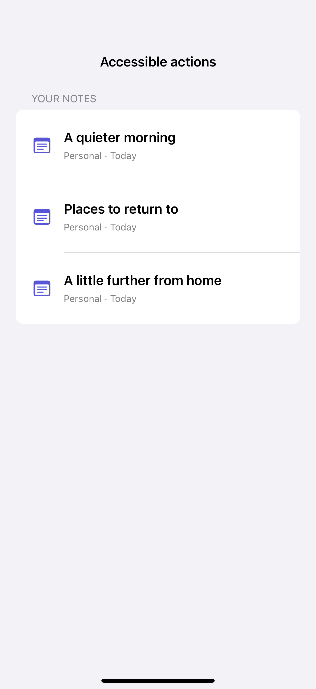
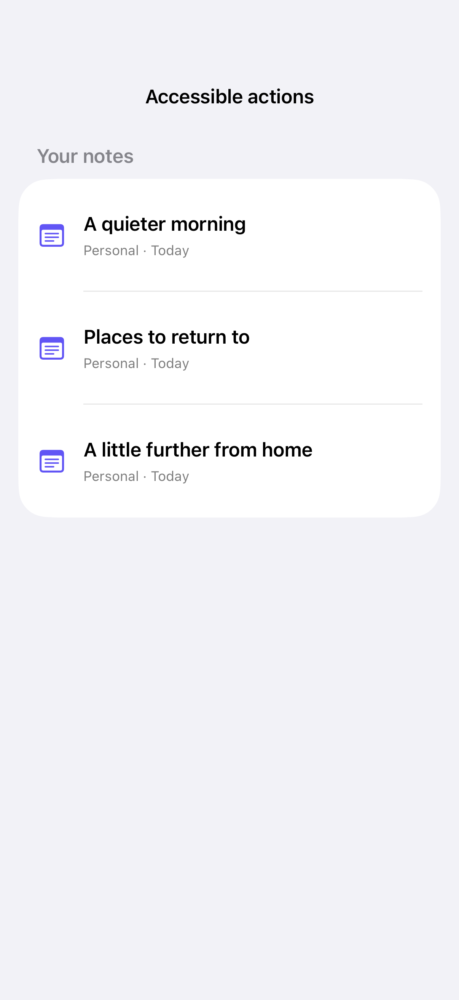

# Custom accessibility actions

Custom actions expose row commands to assistive technology alongside visible swipe and button interactions.

## SwiftUI

```swift
import SwiftUI

struct AccessibleNoteActions: View {
    @State private var favorite = false
    @State private var archived = false

    var body: some View {
        if !archived {
            Label("A quieter morning", systemImage: favorite ? "star.fill" : "note.text")
                .accessibilityElement(children: .combine)
                .accessibilityActions {
                    Button(favorite ? "Remove favorite" : "Add favorite") { favorite.toggle() }
                    Button("Archive") { archived = true }
                }
        }
    }
}
```

## Captures

<!-- captures:start -->
### iPhone 16 Pro · iOS 18.5

default. light appearance; Large text; en_US.



### iPhone 17 Pro · iOS 26.5

default. light appearance; Large text; en_US.


<!-- captures:end -->

## Verification

The default capture uses the system Large text setting. Preview controls affect only this example. No global accessibility settings are changed. Manual VoiceOver traversal, Voice Control, Switch Control, and hardware-keyboard checks remain pending; screenshots do not verify assistive-technology behavior.

## Full example

[Open the complete runnable example](AccessibilityCustomActionsDemo.swift).

## Reference

[Apple: accessibilityActions](https://developer.apple.com/documentation/swiftui/view/accessibilityactions(_:)).
