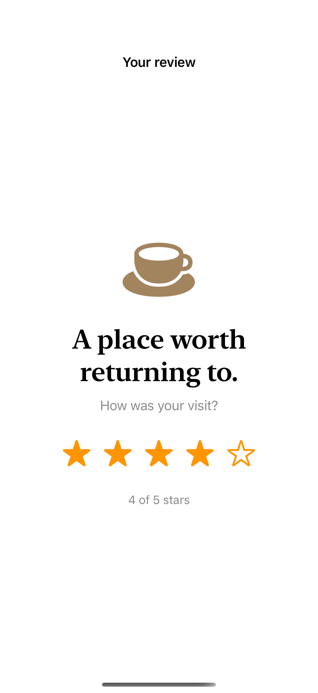
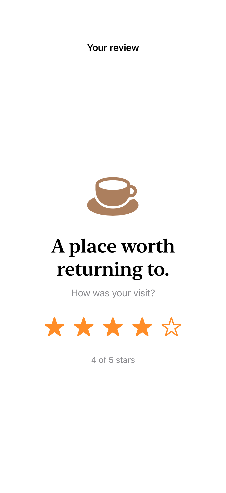

# Adjustable controls

An adjustable accessibility action gives a custom visual control an increment-and-decrement interface.

## SwiftUI

```swift
import SwiftUI

struct AdjustableRating: View {
    @State private var rating = 3

    var body: some View {
        HStack {
            ForEach(1...5, id: \.self) { value in
                Image(systemName: value <= rating ? "star.fill" : "star")
            }
        }
        .accessibilityElement(children: .ignore)
        .accessibilityLabel("Rating")
        .accessibilityValue("\(rating) of 5 stars")
        .accessibilityAdjustableAction {
            switch $0 {
            case .increment: rating = min(5, rating + 1)
            case .decrement: rating = max(1, rating - 1)
            @unknown default: break
            }
        }
    }
}
```

## Captures

<!-- captures:start -->
### iPhone 16 Pro · iOS 18.5

default. light appearance; Large text; en_US.



### iPhone 17 Pro · iOS 26.5

default. light appearance; Large text; en_US.


<!-- captures:end -->

## Verification

The default capture uses the system Large text setting. Preview controls affect only this example. No global accessibility settings are changed. Manual VoiceOver traversal, Voice Control, Switch Control, and hardware-keyboard checks remain pending; screenshots do not verify assistive-technology behavior.

## Full example

[Open the complete runnable example](AccessibleAdjustableControlsDemo.swift).

## Reference

[Apple: accessibilityAdjustableAction](https://developer.apple.com/documentation/swiftui/view/accessibilityadjustableaction(_:)).
