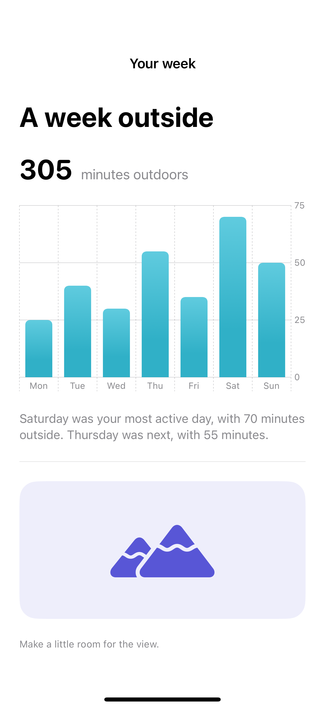
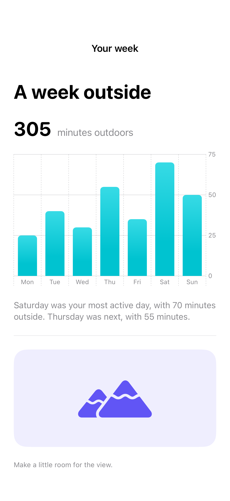

# Accessible data and image summaries

Meaningful text descriptions complement visual information without forcing a person to interpret color or shape.

## SwiftUI

```swift
import SwiftUI
import Charts

struct DescribedChart: View {
    private let minutes = ["Mon": 25, "Tue": 40, "Wed": 30]

    var body: some View {
        VStack(alignment: .leading) {
            Chart(["Mon", "Tue", "Wed"], id: \.self) { day in
                BarMark(x: .value("Day", day), y: .value("Minutes", minutes[day] ?? 0))
                    .accessibilityLabel(day)
                    .accessibilityValue("\(minutes[day] ?? 0) minutes outdoors")
            }
            Text("Tuesday had the most time outdoors: 40 minutes.")
        }
        .frame(height: 240)
    }
}
```

## Captures

<!-- captures:start -->
### iPhone 16 Pro · iOS 18.5

default. light appearance; Large text; en_US.



### iPhone 17 Pro · iOS 26.5

default. light appearance; Large text; en_US.


<!-- captures:end -->

## Verification

The default capture uses the system Large text setting. Preview controls affect only this example. No global accessibility settings are changed. Manual VoiceOver traversal, Voice Control, Switch Control, and hardware-keyboard checks remain pending; screenshots do not verify assistive-technology behavior.

## Full example

[Open the complete runnable example](AccessibleDataSummariesDemo.swift).

## Reference

[Apple: Chart](https://developer.apple.com/documentation/charts).
