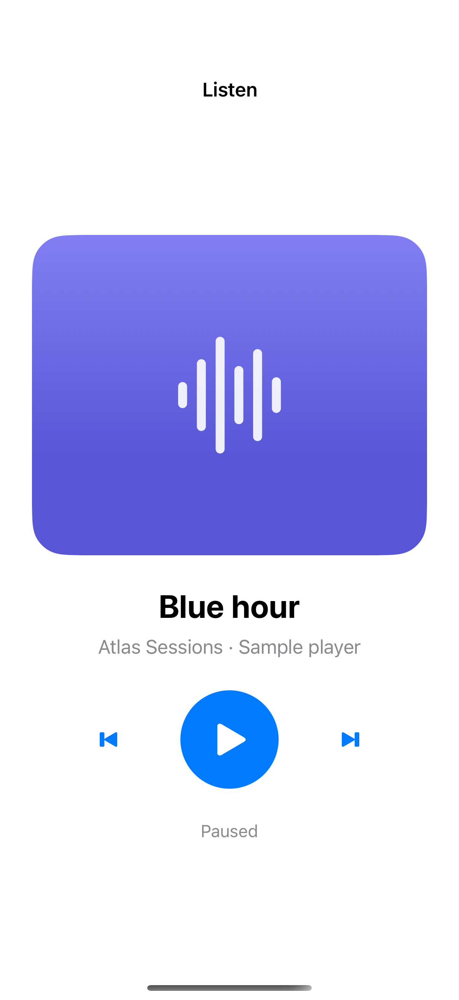
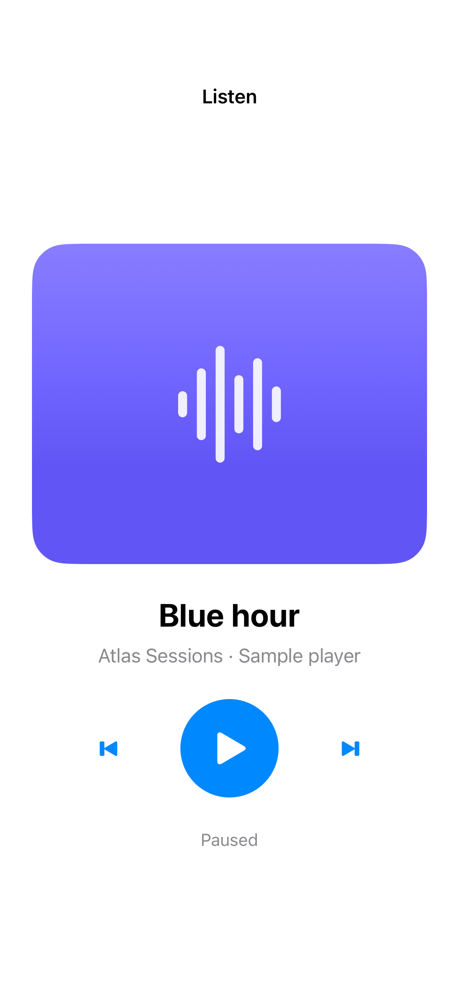

# Touch, keyboard, and voice labels

Comfortable targets, meaningful input labels, and keyboard shortcuts make the same controls usable in different ways.

## SwiftUI

```swift
import SwiftUI

struct AccessiblePlayButton: View {
    @State private var playing = false

    var body: some View {
        Button { playing.toggle() } label: {
            Image(systemName: playing ? "pause.fill" : "play.fill")
                .frame(minWidth: 44, minHeight: 44)
                .contentShape(Rectangle())
        }
        .accessibilityLabel(playing ? "Pause" : "Play")
        .accessibilityInputLabels(playing ? ["Pause", "Pause playback"] : ["Play", "Start playback"])
        .keyboardShortcut(.space, modifiers: [])
    }
}
```

## Captures

<!-- captures:start -->
### iPhone 16 Pro · iOS 18.5

default. light appearance; Large text; en_US.



### iPhone 17 Pro · iOS 26.5

default. light appearance; Large text; en_US.


<!-- captures:end -->

## Verification

The default capture uses the system Large text setting. Preview controls affect only this example. No global accessibility settings are changed. Manual VoiceOver traversal, Voice Control, Switch Control, and hardware-keyboard checks remain pending; screenshots do not verify assistive-technology behavior.

## Full example

[Open the complete runnable example](AccessibleInputControlsDemo.swift).

## Reference

[Apple: accessibilityInputLabels](https://developer.apple.com/documentation/swiftui/accessible-controls).
