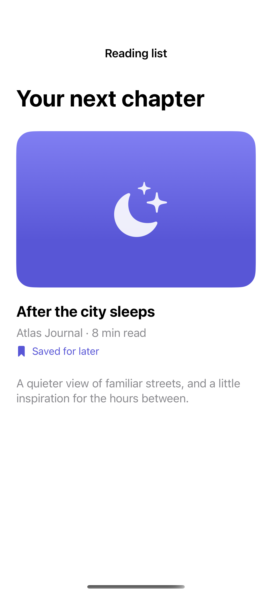
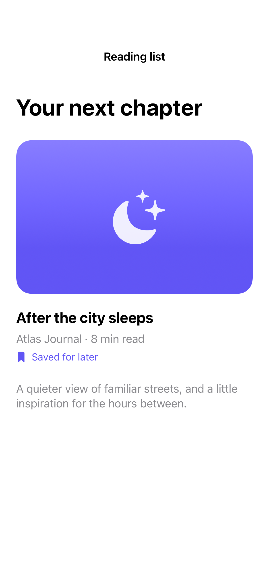

# Labels and logical groups

Accessible labels and groups turn a visual arrangement into a concise, meaningful reading order.

## SwiftUI

```swift
import SwiftUI

struct AccessibleBookSummary: View {
    var body: some View {
        HStack {
            Image(systemName: "book.closed").accessibilityHidden(true)
            VStack(alignment: .leading) {
                Text("After the city sleeps")
                Text("8 min read").foregroundStyle(.secondary)
            }
        }
        .accessibilityElement(children: .ignore)
        .accessibilityLabel("After the city sleeps")
        .accessibilityValue("Eight minute read")
    }
}
```

## Captures

<!-- captures:start -->
### iPhone 16 Pro · iOS 18.5

default. light appearance; Large text; en_US.



### iPhone 17 Pro · iOS 26.5

default. light appearance; Large text; en_US.



### iPhone 18 Pro · iOS 27.0

default. light appearance; Large text; en_US.


<!-- captures:end -->

## Verification

The default capture uses the system Large text setting. Preview controls affect only this example. No global accessibility settings are changed. Manual VoiceOver traversal, Voice Control, Switch Control, and hardware-keyboard checks remain pending; screenshots do not verify assistive-technology behavior.

## Full example

[Open the complete runnable example](AccessibleLabelsGroupsDemo.swift).

## Reference

[Apple: accessibilityElement](https://developer.apple.com/documentation/swiftui/accessible-descriptions).
