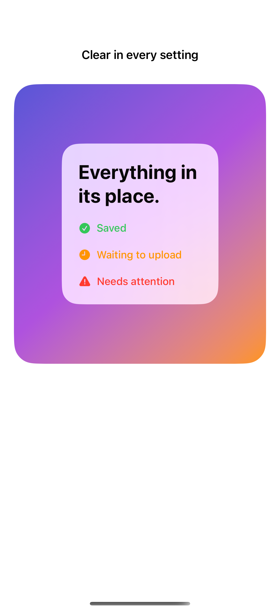
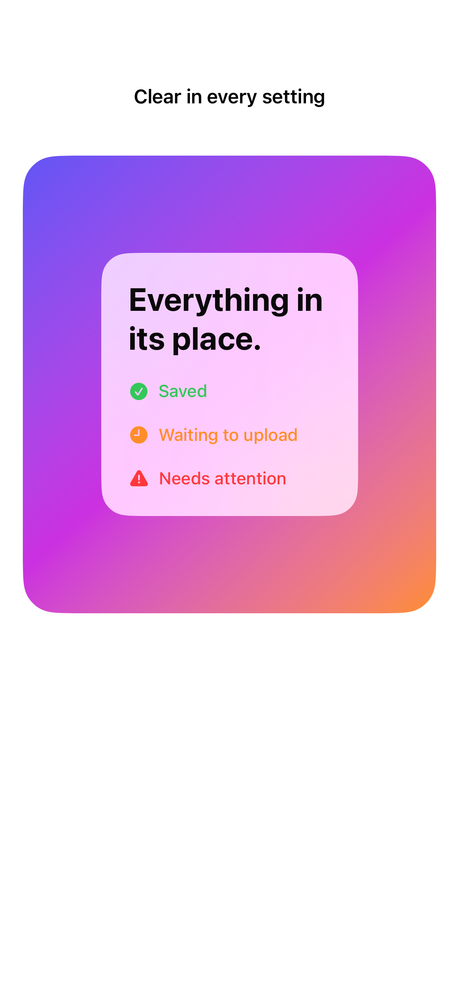

# Contrast and transparency

Semantic colors, opaque fallbacks, and explicit symbols preserve meaning across accessibility display preferences.

## SwiftUI

```swift
import SwiftUI

struct AccessibleMaterialCard: View {
    @Environment(\.accessibilityReduceTransparency) private var opaque
    @Environment(\.colorSchemeContrast) private var contrast

    var body: some View {
        Label("Saved", systemImage: "checkmark.circle.fill")
            .padding(24)
            .background(opaque ? AnyShapeStyle(Color(uiColor: .systemBackground)) : AnyShapeStyle(.regularMaterial),
                        in: .rect(cornerRadius: 20))
            .overlay {
                RoundedRectangle(cornerRadius: 20)
                    .stroke(contrast == .increased ? Color.primary : .clear, lineWidth: 2)
            }
    }
}
```

## Captures

<!-- captures:start -->
### iPhone 16 Pro · iOS 18.5

default. light appearance; Large text; en_US.



### iPhone 17 Pro · iOS 26.5

default. light appearance; Large text; en_US.


<!-- captures:end -->

## Verification

The default capture uses the system Large text setting. Preview controls affect only this example. No global accessibility settings are changed. Manual VoiceOver traversal, Voice Control, Switch Control, and hardware-keyboard checks remain pending; screenshots do not verify assistive-technology behavior.

## Full example

[Open the complete runnable example](ContrastTransparencyAdaptationDemo.swift).

## Reference

[Apple: accessibilityReduceTransparency](https://developer.apple.com/documentation/swiftui/environmentvalues/accessibilityreducetransparency).
