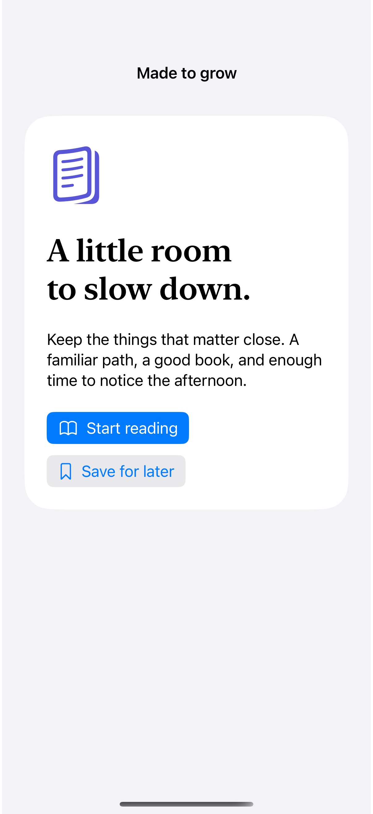
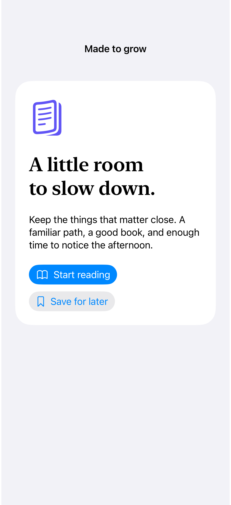

# Dynamic Type layouts

Scaled typography and flexible arrangements let a layout grow with the person’s preferred reading size.

## SwiftUI

```swift
import SwiftUI

struct ScaledReadingCard: View {
    @ScaledMetric(relativeTo: .title) private var iconSize = 48

    var body: some View {
        VStack(alignment: .leading, spacing: 20) {
            Image(systemName: "book").font(.system(size: iconSize))
            Text("A little room to slow down.").font(.largeTitle)
            ViewThatFits(in: .horizontal) {
                HStack { Button("Read") { }; Button("Save for later") { } }
                VStack(alignment: .leading) { Button("Read") { }; Button("Save for later") { } }
            }
        }
        .padding()
    }
}
```

## Captures

<!-- captures:start -->
### iPhone 16 Pro · iOS 18.5

default. light appearance; Large text; en_US.



### iPhone 17 Pro · iOS 26.5

default. light appearance; Large text; en_US.


<!-- captures:end -->

## Verification

The default capture uses the system Large text setting. Preview controls affect only this example. No global accessibility settings are changed. Manual VoiceOver traversal, Voice Control, Switch Control, and hardware-keyboard checks remain pending; screenshots do not verify assistive-technology behavior.

## Full example

[Open the complete runnable example](DynamicTypeLayoutsDemo.swift).

## Reference

[Apple: dynamicTypeSize](https://developer.apple.com/documentation/swiftui/dynamictypesize).
