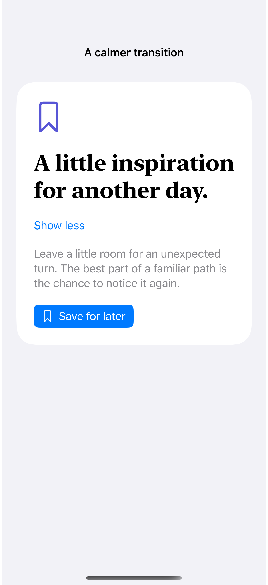
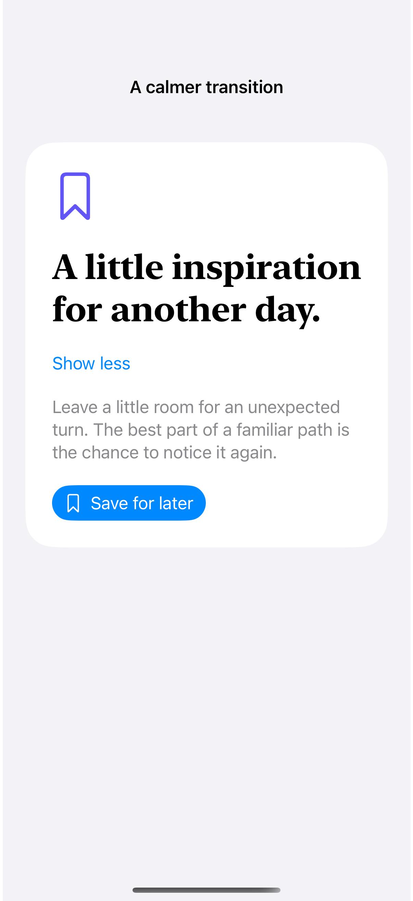

# Reduced motion

Motion-sensitive interfaces can replace spatial transitions with a simpler, immediate state change.

## SwiftUI

```swift
import SwiftUI

struct MotionAwareDisclosure: View {
    @Environment(\.accessibilityReduceMotion) private var reduceMotion
    @State private var expanded = false

    var body: some View {
        VStack {
            Button("Details") {
                withAnimation(reduceMotion ? nil : .spring) { expanded.toggle() }
            }
            if expanded {
                Text("A little more context.")
                    .transition(reduceMotion ? .identity : .move(edge: .top).combined(with: .opacity))
            }
        }
    }
}
```

## Captures

<!-- captures:start -->
### iPhone 16 Pro · iOS 18.5

default. light appearance; Large text; en_US.



### iPhone 17 Pro · iOS 26.5

default. light appearance; Large text; en_US.


<!-- captures:end -->

## Verification

The default capture is a settled state. Reduced Motion is read from the environment; the preview switch changes only this example. A static capture cannot verify the transition. No global accessibility settings are changed. Manual VoiceOver traversal, Voice Control, Switch Control, and hardware-keyboard checks remain pending; screenshots do not verify assistive-technology behavior.

## Full example

[Open the complete runnable example](ReducedMotionAdaptationDemo.swift).

## Reference

[Apple: accessibilityReduceMotion](https://developer.apple.com/documentation/swiftui/environmentvalues/accessibilityreducemotion).
