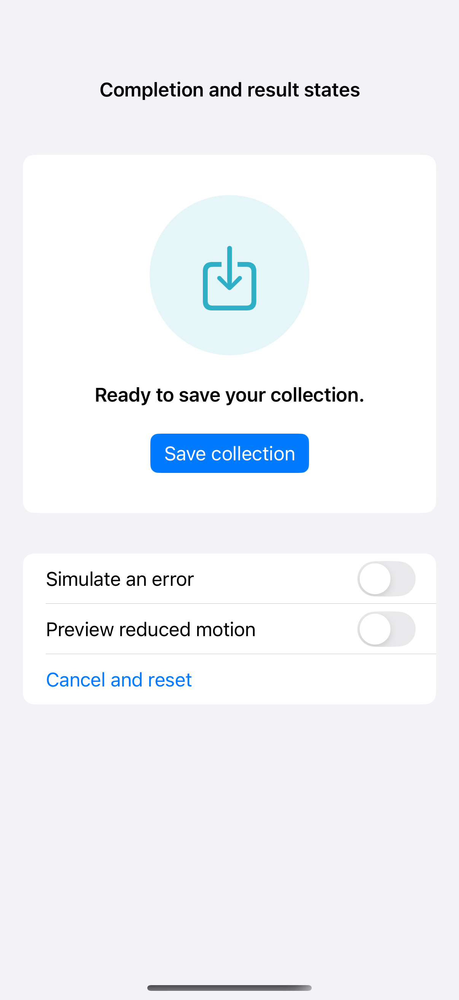
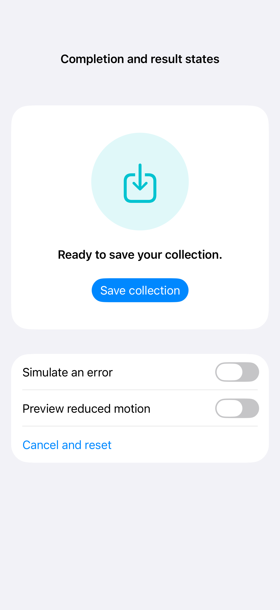

# Completion and result states

An animation completion callback can coordinate the next visual or status update after a state change finishes. This local simulation moves from ready to working and then success or error, with cancellation and reduced-motion handling; the capture records its ready state.

## SwiftUI

```swift
import SwiftUI

struct AnimationCompletionRecipe: View {
    @Environment(\.accessibilityReduceMotion) private var reduceMotion
    @State private var expanded = false
    @State private var status = "Ready"
    var body: some View {
        VStack(spacing: 24) {
            RoundedRectangle(cornerRadius: 20).fill(.teal)
                .frame(width: expanded ? 220 : 100, height: 100)
            Text(status)
            Button("Animate") {
                status = "Moving"
                withAnimation(reduceMotion ? nil : .smooth, completionCriteria: .logicallyComplete) {
                    expanded.toggle()
                } completion: {
                    status = "Finished"
                }
            }
        }
    }
}
```

## Captures

<!-- captures:start -->
### iPhone 16 Pro · iOS 18.5

default. light appearance; Large text; en_US.



### iPhone 17 Pro · iOS 26.5

default. light appearance; Large text; en_US.


<!-- captures:end -->

## Full example

[Open the complete runnable example](AnimationCompletionDemo.swift).

## Reference

[Apple: motion](https://developer.apple.com/design/human-interface-guidelines/motion).
