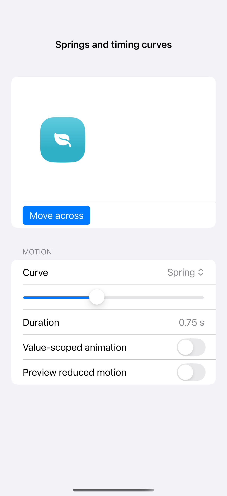
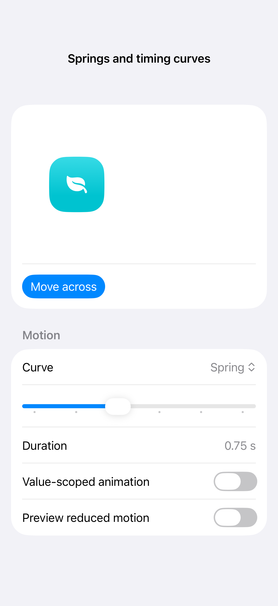

# Springs and timing curves

Animation interpolates a view between state changes. Springs and timing curves create different pacing, and a new target can interrupt an animation already in progress; use the app to compare motion because a still capture only shows a resting state.

## SwiftUI

```swift
import SwiftUI

struct AnimationCurveRecipe: View {
    @Environment(\.accessibilityReduceMotion) private var reduceMotion
    @State private var moved = false
    var body: some View {
        VStack(spacing: 32) {
            Circle().fill(.teal).frame(width: 72, height: 72)
                .offset(x: moved ? 80 : -80)
            Button("Move") {
                withAnimation(reduceMotion ? nil : .spring(duration: 0.6, bounce: 0.3)) {
                    moved.toggle()
                }
            }
        }.padding(40)
    }
}
```

## Captures

<!-- captures:start -->
### iPhone 16 Pro · iOS 18.5

default. light appearance; Large text; en_US.



### iPhone 17 Pro · iOS 26.5

default. light appearance; Large text; en_US.


<!-- captures:end -->

## Full example

[Open the complete runnable example](AnimationCurvesDemo.swift).

## Reference

[Apple: motion](https://developer.apple.com/design/human-interface-guidelines/motion).
