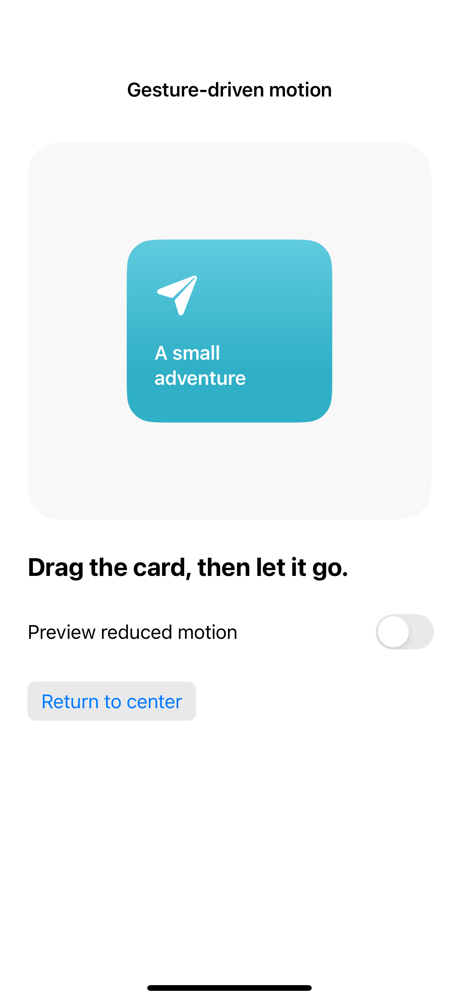
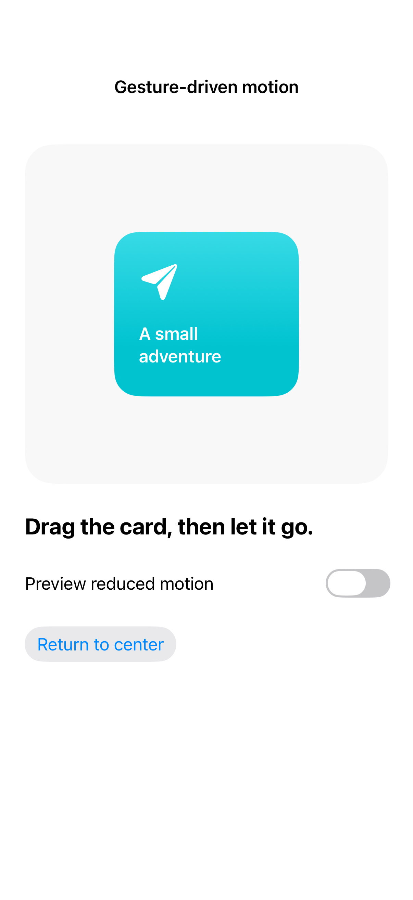

# Gesture-driven motion

A drag can update position directly while a release animates the content back to rest. Keep the drag bounds clear and remove decorative rotation and spring movement for reduced motion; the capture shows the centered resting card.

## SwiftUI

```swift
import SwiftUI

struct DragMotionRecipe: View {
    @Environment(\.accessibilityReduceMotion) private var reduceMotion
    @State private var offset = CGSize.zero
    var body: some View {
        RoundedRectangle(cornerRadius: 24).fill(.teal).frame(width: 160, height: 120)
            .offset(offset)
            .gesture(DragGesture()
                .onChanged { offset = $0.translation }
                .onEnded { _ in
                    withAnimation(reduceMotion ? nil : .spring(duration: 0.5)) { offset = .zero }
                })
    }
}
```

## Captures

<!-- captures:start -->
### iPhone 16 Pro · iOS 18.5

default. light appearance; Large text; en_US.



### iPhone 17 Pro · iOS 26.5

default. light appearance; Large text; en_US.


<!-- captures:end -->

## Full example

[Open the complete runnable example](GestureDrivenMotionDemo.swift).

## Reference

[Apple: motion](https://developer.apple.com/design/human-interface-guidelines/motion).
