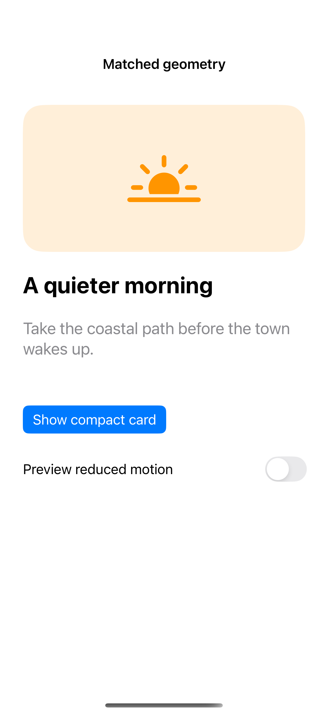
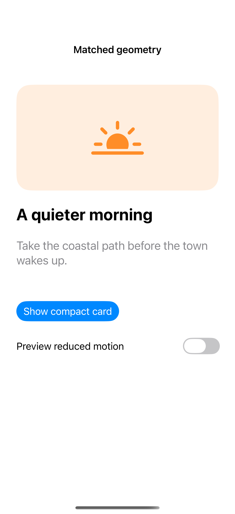
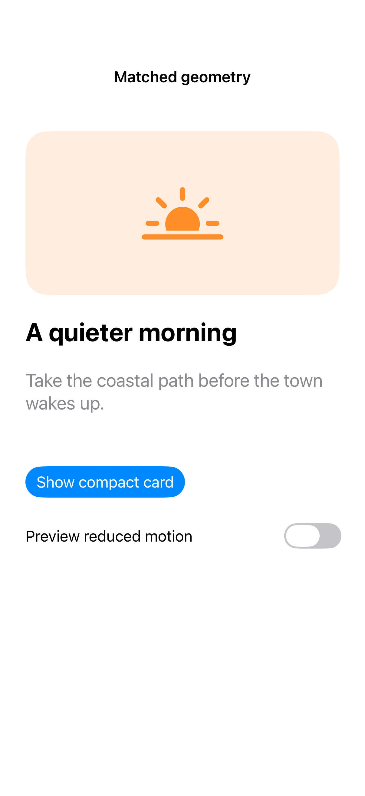

# Matched geometry

Matched geometry links corresponding views across two arrangements in the same hierarchy. It can connect a compact card to an expanded composition while retaining the item’s identity; the capture records the expanded resting state, not the transition itself.

## SwiftUI

```swift
import SwiftUI

struct MatchedGeometryRecipe: View {
    @Environment(\.accessibilityReduceMotion) private var reduceMotion
    @Namespace private var geometry
    @State private var expanded = false
    var body: some View {
        VStack(spacing: 24) {
            if expanded {
                RoundedRectangle(cornerRadius: 24).fill(.teal)
                    .matchedGeometryEffect(id: "card", in: geometry)
                    .frame(width: 280, height: 180)
            } else {
                RoundedRectangle(cornerRadius: 24).fill(.teal)
                    .matchedGeometryEffect(id: "card", in: geometry)
                    .frame(width: 100, height: 100)
            }
            Button("Change arrangement") {
                withAnimation(reduceMotion ? nil : .smooth) { expanded.toggle() }
            }
        }
    }
}
```

## Captures

<!-- captures:start -->
### iPhone 16 Pro · iOS 18.5

default. light appearance; Large text; en_US.



### iPhone 17 Pro · iOS 26.5

default. light appearance; Large text; en_US.



### iPhone 18 Pro · iOS 27.0

default. light appearance; Large text; en_US.


<!-- captures:end -->

## Full example

[Open the complete runnable example](MatchedGeometryDemo.swift).

## Reference

[Apple: motion](https://developer.apple.com/design/human-interface-guidelines/motion).
