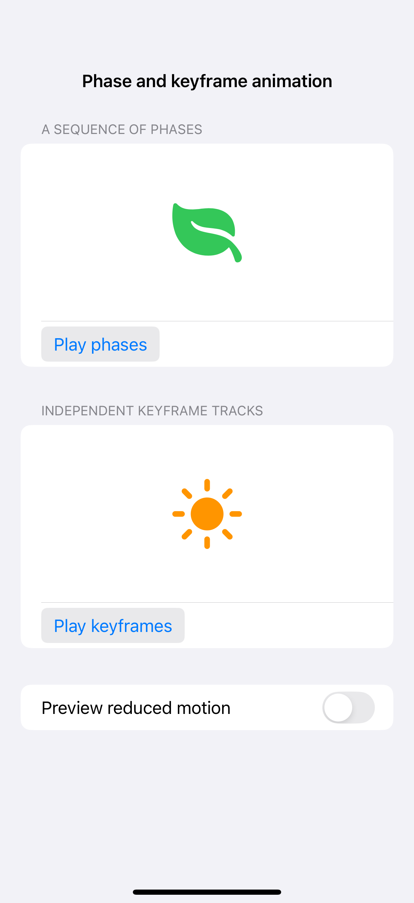
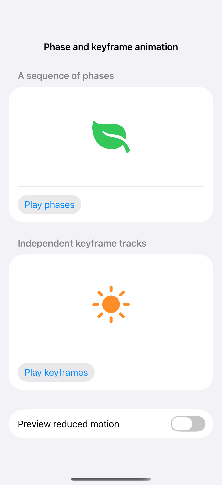

# Phase and keyframe animation

A phase animator moves through a set of states, while keyframe tracks describe independent changes over time. Triggered sequences return to a predictable resting pose here, and reduced motion leaves the symbols still; a screenshot does not demonstrate the sequence.

## SwiftUI

```swift
import SwiftUI

struct PhaseAnimationRecipe: View {
    @Environment(\.accessibilityReduceMotion) private var reduceMotion
    @State private var trigger = 0
    var body: some View {
        VStack(spacing: 32) {
            Image(systemName: "leaf.fill").font(.system(size: 64)).foregroundStyle(.green)
                .phaseAnimator([false, true], trigger: trigger) { content, raised in
                    content.scaleEffect(raised && !reduceMotion ? 1.2 : 1)
                }
            Button("Play sequence") { trigger += 1 }
        }
    }
}
```

## Captures

<!-- captures:start -->
### iPhone 16 Pro · iOS 18.5

default. light appearance; Large text; en_US.



### iPhone 17 Pro · iOS 26.5

default. light appearance; Large text; en_US.


<!-- captures:end -->

## Full example

[Open the complete runnable example](PhaseKeyframeDemo.swift).

## Reference

[Apple: motion](https://developer.apple.com/design/human-interface-guidelines/motion).
