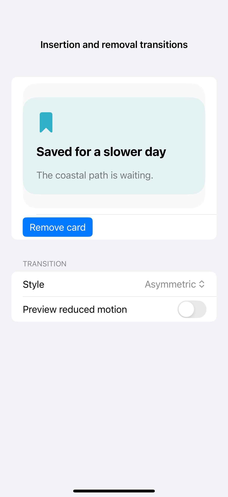
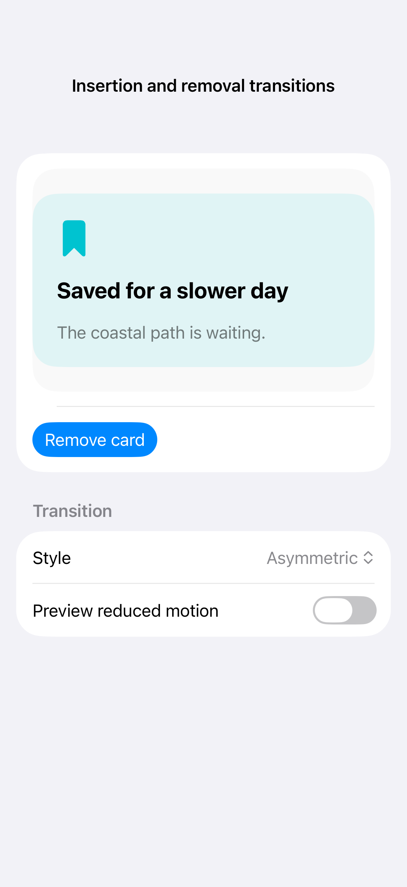

# Insertion and removal transitions

A transition defines how conditional content enters or leaves a view hierarchy. Asymmetric transitions give insertion and removal different treatments, with an opacity-only alternative for reduced motion; screenshots show the visible endpoint rather than the movement.

## SwiftUI

```swift
import SwiftUI

struct ViewTransitionRecipe: View {
    @Environment(\.accessibilityReduceMotion) private var reduceMotion
    @State private var visible = true
    var body: some View {
        VStack(spacing: 24) {
            if visible {
                Text("Saved for later").padding(24)
                    .background(.teal.opacity(0.12), in: RoundedRectangle(cornerRadius: 20))
                    .transition(reduceMotion ? .opacity : .move(edge: .bottom).combined(with: .opacity))
            }
            Button("Toggle card") {
                withAnimation(.easeInOut(duration: 0.3)) { visible.toggle() }
            }
        }
    }
}
```

## Captures

<!-- captures:start -->
### iPhone 16 Pro · iOS 18.5

default. light appearance; Large text; en_US.



### iPhone 17 Pro · iOS 26.5

default. light appearance; Large text; en_US.


<!-- captures:end -->

## Full example

[Open the complete runnable example](ViewTransitionsDemo.swift).

## Reference

[Apple: motion](https://developer.apple.com/design/human-interface-guidelines/motion).
