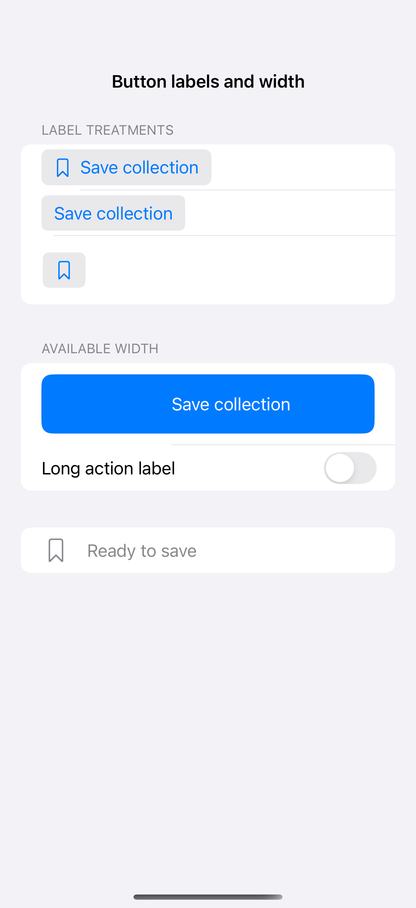
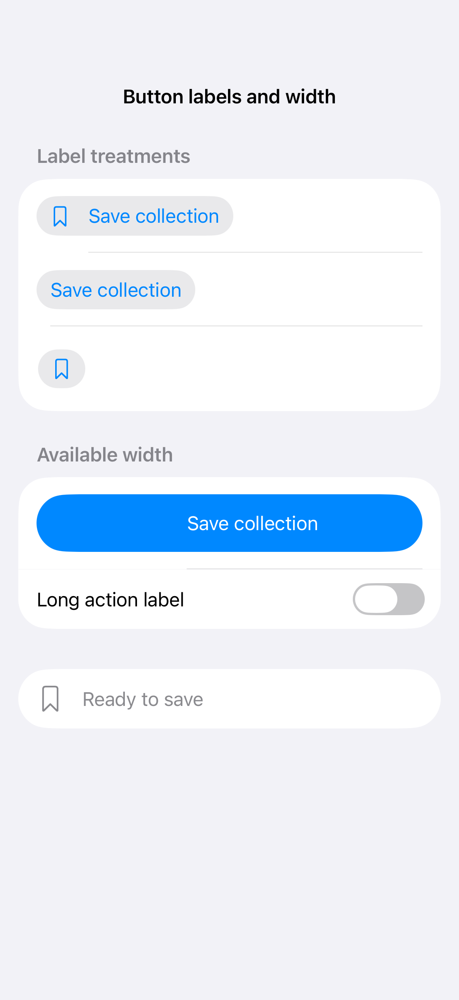
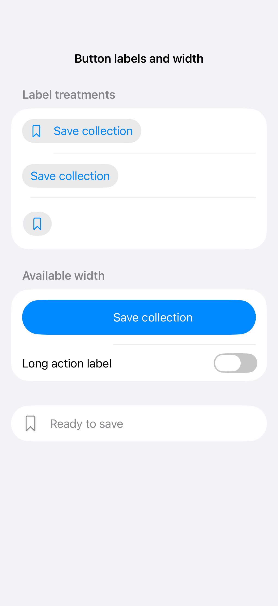

# Button labels and width

A button’s label can show text, a symbol, or both. Give icon-only actions an accessible name, and place an expanding frame inside the label when the entire available width should be tappable.

## SwiftUI

```swift
import SwiftUI

struct ButtonLabelsRecipe: View {
    @State private var isSaved = false
    var body: some View {
        Button { isSaved.toggle() } label: {
            Label(isSaved ? "Saved" : "Save collection", systemImage: "bookmark")
                .frame(maxWidth: .infinity)
        }
        .buttonStyle(.borderedProminent)
        .controlSize(.large)
    }
}
```

## Captures

<!-- captures:start -->
### iPhone 16 Pro · iOS 18.5

default. light appearance; Large text; en_US.



### iPhone 17 Pro · iOS 26.5

default. light appearance; Large text; en_US.



### iPhone 18 Pro · iOS 27.0

default. light appearance; Large text; en_US.


<!-- captures:end -->

## Full example

[Open the complete runnable example](ButtonLabelsDemo.swift).

## Reference

[Apple: buttons](https://developer.apple.com/design/human-interface-guidelines/buttons).
