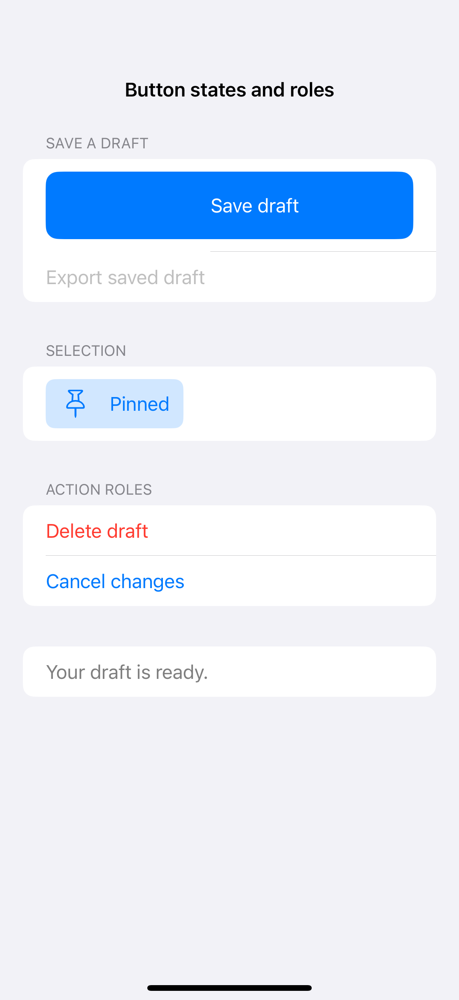
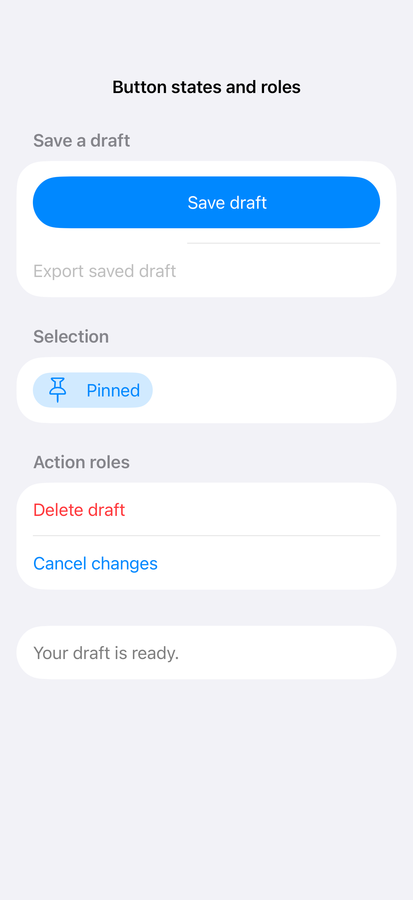

# Button states and roles

A button can communicate progress and success while roles distinguish ordinary, destructive, and cancellation actions. Disable unavailable operations and keep the label stable enough that a state change does not disrupt the layout.

## SwiftUI

```swift
import SwiftUI

struct ButtonStatesRecipe: View {
    @State private var isSaving = false
    @State private var saved = false
    var body: some View {
        Button {
            isSaving = true
            Task {
                try? await Task.sleep(for: .seconds(1))
                saved = true
                isSaving = false
            }
        } label: {
            HStack {
                if isSaving { ProgressView() }
                Text(isSaving ? "Saving…" : saved ? "Saved" : "Save")
            }
        }
        .buttonStyle(.borderedProminent)
        .disabled(isSaving)
    }
}
```

## Captures

<!-- captures:start -->
### iPhone 16 Pro · iOS 18.5

default. light appearance; Large text; en_US.



### iPhone 17 Pro · iOS 26.5

default. light appearance; Large text; en_US.


<!-- captures:end -->

## Full example

[Open the complete runnable example](ButtonStatesDemo.swift).

## Reference

[Apple: buttons](https://developer.apple.com/design/human-interface-guidelines/buttons).
