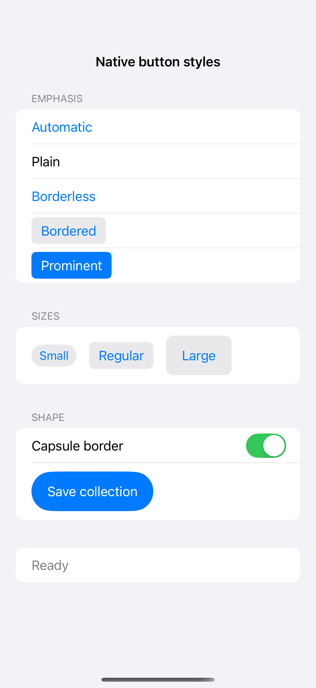
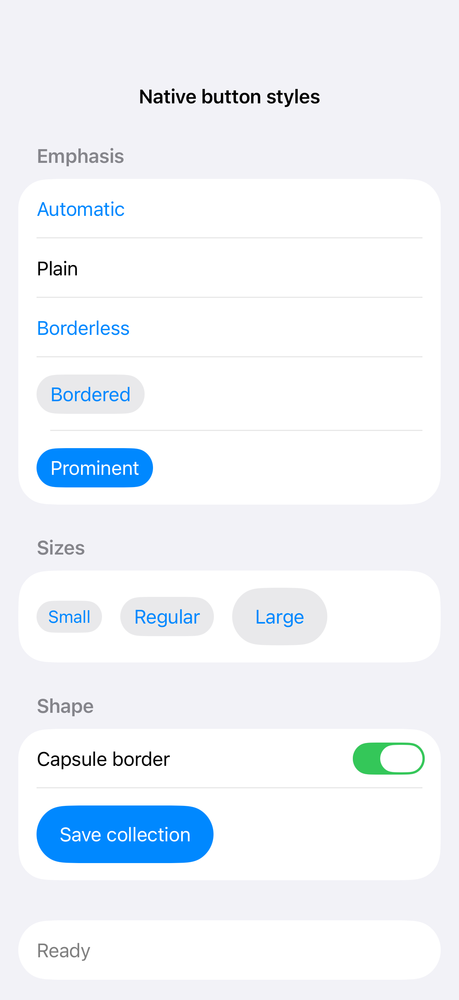

# Native button styles

Native button styles express emphasis while preserving system interaction and accessibility. Control size and border shape adjust the treatment without replacing the button’s built-in behavior.

## SwiftUI

```swift
import SwiftUI

struct NativeButtonStylesRecipe: View {
    @State private var saved = false
    var body: some View {
        Button(saved ? "Saved" : "Save collection") { saved.toggle() }
            .buttonStyle(.borderedProminent)
            .controlSize(.large)
            .buttonBorderShape(.capsule)
    }
}
```

## Captures

<!-- captures:start -->
### iPhone 16 Pro · iOS 18.5

default. light appearance; Large text; en_US.



### iPhone 17 Pro · iOS 26.5

default. light appearance; Large text; en_US.


<!-- captures:end -->

## Full example

[Open the complete runnable example](NativeButtonStylesDemo.swift).

## Reference

[Apple: buttons](https://developer.apple.com/design/human-interface-guidelines/buttons).
