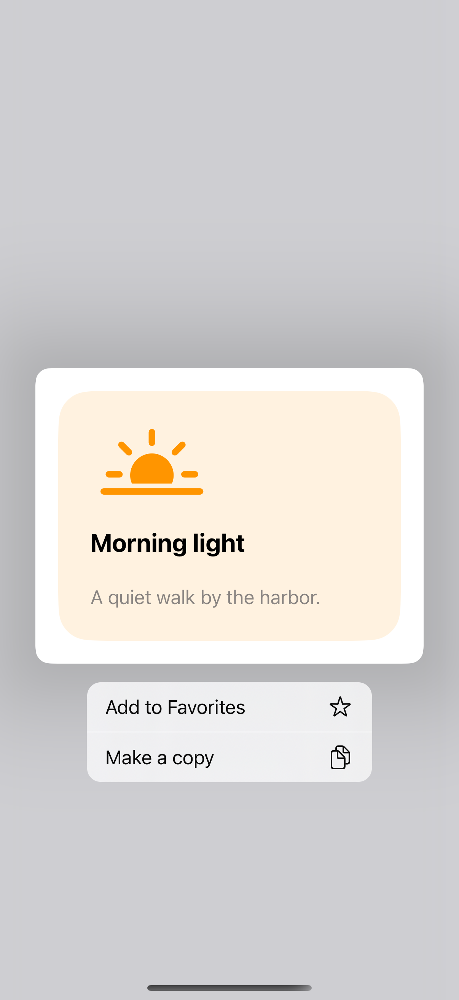
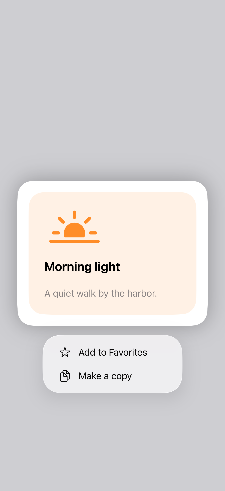
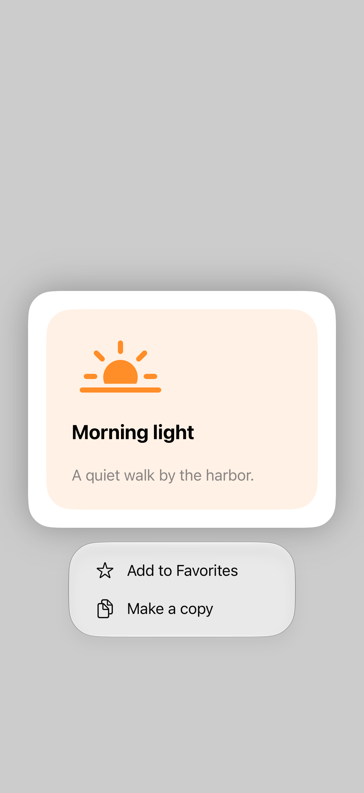

# Context menus and selection

A context menu attaches actions to the content they affect. A preview can preserve the item’s identity, while a selection-aware list menu receives the items targeted by the interaction so actions can work on one item or a group.

## SwiftUI

```swift
import SwiftUI

struct ContextMenuRecipe: View {
    @State private var favorite = false
    var body: some View {
        Label("Morning light", systemImage: "sun.horizon.fill")
            .padding(32)
            .contextMenu {
                Button(favorite ? "Remove favorite" : "Add favorite") { favorite.toggle() }
            } preview: {
                Image(systemName: "sun.horizon.fill")
                    .font(.system(size: 80)).padding(60)
            }
    }
}
```

## Captures

<!-- captures:start -->
### iPhone 16 Pro · iOS 18.5

default. light appearance; Large text; en_US.



### iPhone 17 Pro · iOS 26.5

default. light appearance; Large text; en_US.



### iPhone 18 Pro · iOS 27.0

default. light appearance; Large text; en_US.


<!-- captures:end -->

## Full example

[Open the complete runnable example](ContextMenusDemo.swift).

## Reference

[Apple: menus](https://developer.apple.com/design/human-interface-guidelines/menus).
