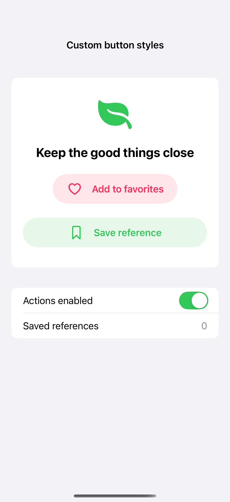
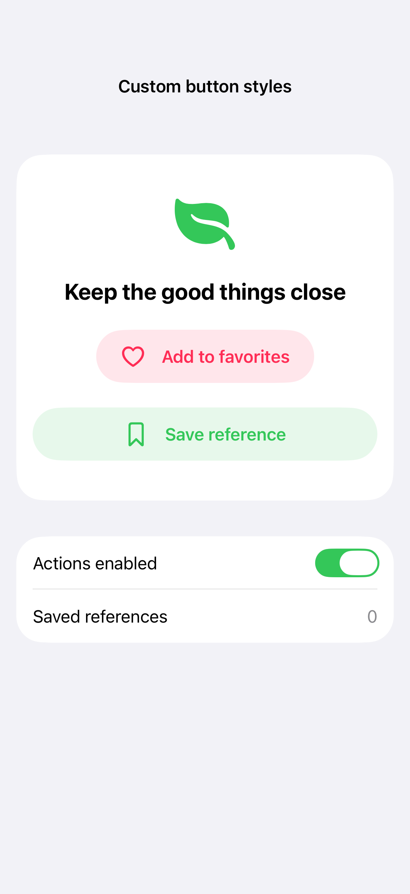
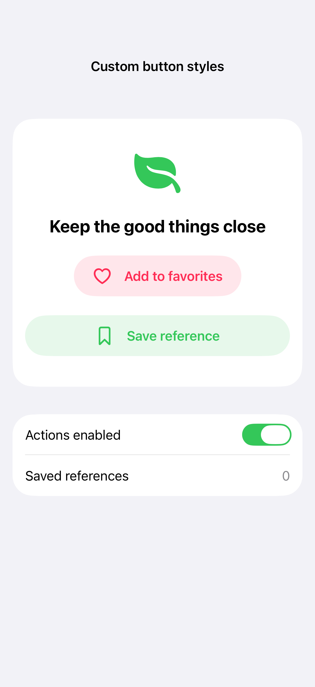

# Custom button styles

A custom button style changes the visual response to pressing while retaining a native button’s action and accessibility semantics. Give the label a comfortable hit area and reflect disabled state and Reduce Motion in the style.

## SwiftUI

```swift
import SwiftUI

struct CustomButtonRecipe: View {
    @State private var saved = false
    var body: some View {
        Button(saved ? "Saved" : "Save") { saved.toggle() }
            .buttonStyle(SoftButtonRecipeStyle())
    }
}

private struct SoftButtonRecipeStyle: ButtonStyle {
    @Environment(\.isEnabled) private var isEnabled
    func makeBody(configuration: Configuration) -> some View {
        configuration.label
            .padding(.horizontal, 24).frame(minHeight: 48)
            .background(.tint.opacity(configuration.isPressed ? 0.25 : 0.12), in: Capsule())
            .contentShape(Capsule())
            .opacity(isEnabled ? 1 : 0.4)
    }
}
```

## Captures

<!-- captures:start -->
### iPhone 16 Pro · iOS 18.5

default. light appearance; Large text; en_US.



### iPhone 17 Pro · iOS 26.5

default. light appearance; Large text; en_US.



### iPhone 18 Pro · iOS 27.0

default. light appearance; Large text; en_US.


<!-- captures:end -->

## Full example

[Open the complete runnable example](CustomButtonStylesDemo.swift).

## Reference

[Apple: buttons](https://developer.apple.com/design/human-interface-guidelines/buttons).
