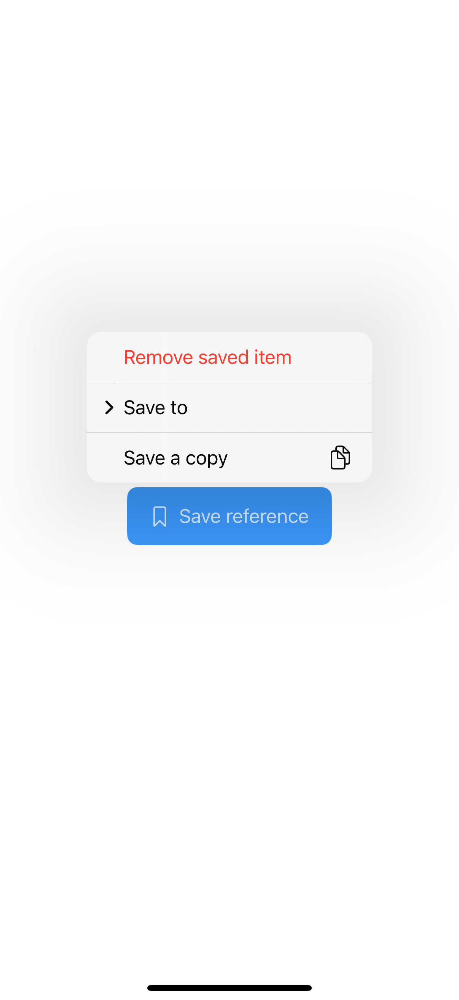
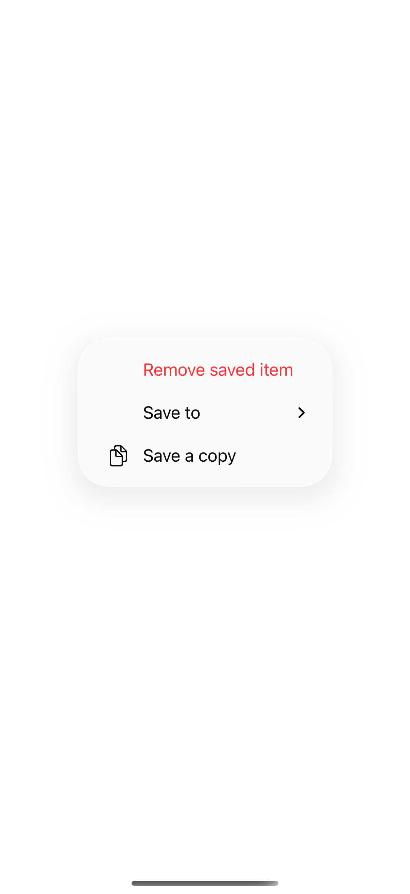
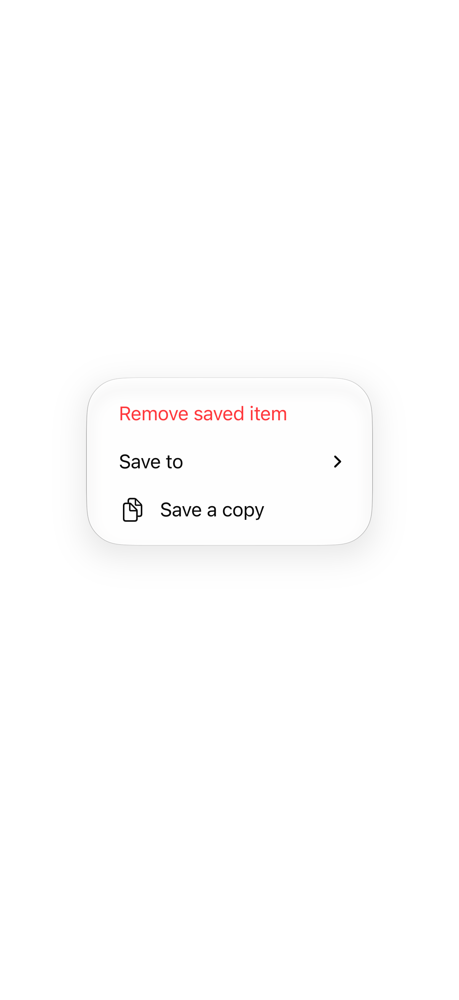

# Menus with a primary action

A menu with a primary action performs its most common operation on a tap and reveals secondary actions on a long press. Its label should make the quick action clear while keeping related alternatives nearby.

## SwiftUI

```swift
import SwiftUI

struct PrimaryMenuRecipe: View {
    @State private var saved = false
    var body: some View {
        Menu {
            Button("Save a copy") { saved = true }
            Button("Remove saved item", role: .destructive) { saved = false }
        } label: {
            Label(saved ? "Saved" : "Save", systemImage: "bookmark")
        } primaryAction: {
            saved.toggle()
        }
    }
}
```

## Captures

<!-- captures:start -->
### iPhone 16 Pro · iOS 18.5

default. light appearance; Large text; en_US.



### iPhone 17 Pro · iOS 26.5

default. light appearance; Large text; en_US.



### iPhone 18 Pro · iOS 27.0

default. light appearance; Large text; en_US.


<!-- captures:end -->

## Full example

[Open the complete runnable example](MenuPrimaryActionsDemo.swift).

## Reference

[Apple: menus](https://developer.apple.com/design/human-interface-guidelines/menus).
