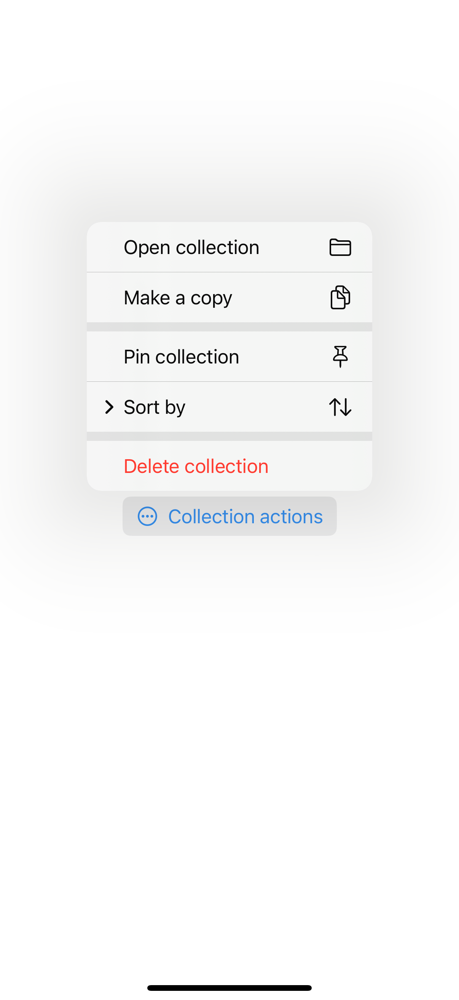
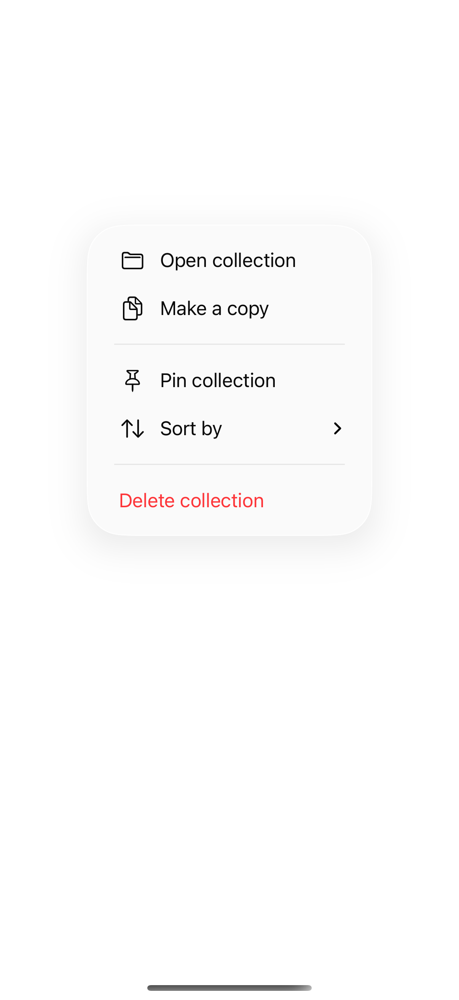
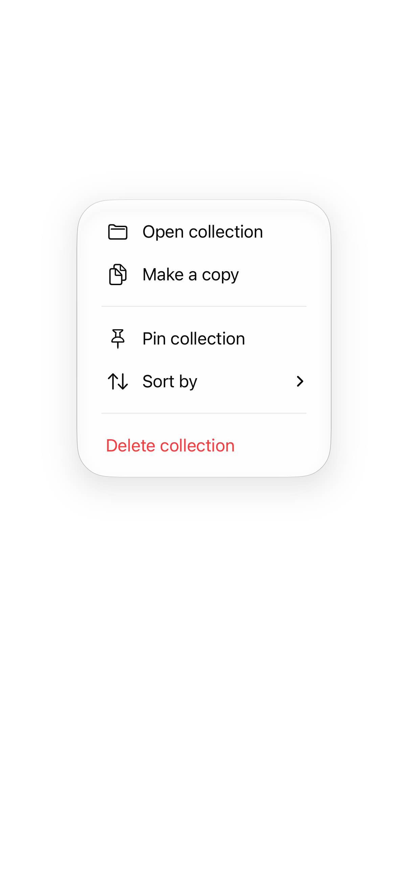

# Sections and nested menus

A menu groups related actions in a small contextual surface. Sections separate tasks, nested menus organize secondary choices, and a picker marks the current value without requiring a custom selection indicator.

## SwiftUI

```swift
import SwiftUI

struct NativeMenuRecipe: View {
    @State private var sort = "Newest"
    var body: some View {
        Menu("Collection actions", systemImage: "ellipsis.circle") {
            Button("Open collection") { /* Open the selected collection. */ }
            Menu("Sort by") {
                Picker("Sort order", selection: $sort) {
                    Text("Newest").tag("Newest")
                    Text("Title").tag("Title")
                }
            }
            Button("Delete", role: .destructive) { /* Delete after confirming intent. */ }
        }
    }
}
```

## Captures

<!-- captures:start -->
### iPhone 16 Pro · iOS 18.5

default. light appearance; Large text; en_US.



### iPhone 17 Pro · iOS 26.5

default. light appearance; Large text; en_US.



### iPhone 18 Pro · iOS 27.0

default. light appearance; Large text; en_US.


<!-- captures:end -->

## Full example

[Open the complete runnable example](NativeMenusDemo.swift).

## Reference

[Apple: menus](https://developer.apple.com/design/human-interface-guidelines/menus).
