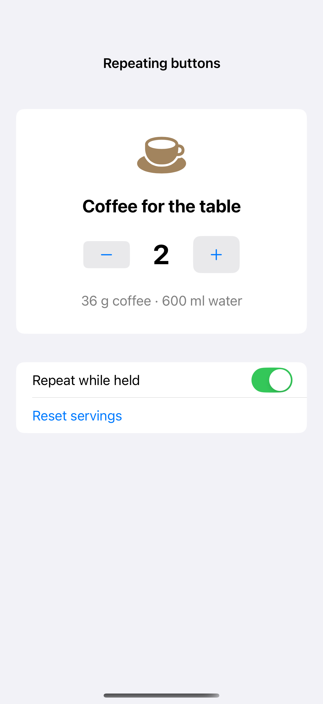
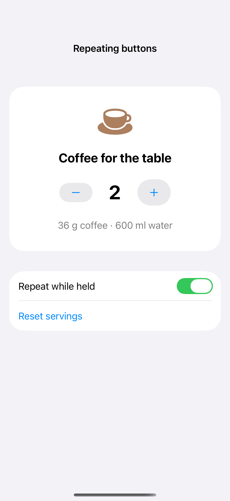
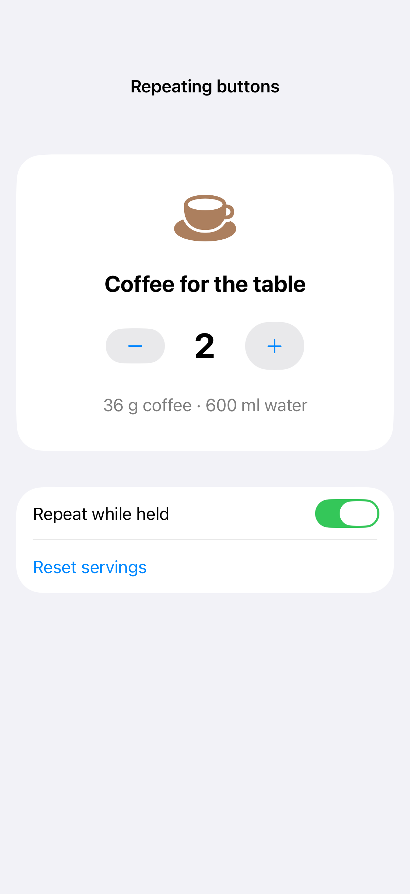

# Repeating buttons

A repeating button performs its action while it remains pressed. This is useful for small bounded adjustments, with disabled states at the limits and an accessible value that explains the current setting.

## SwiftUI

```swift
import SwiftUI

struct RepeatingButtonRecipe: View {
    @State private var servings = 2
    var body: some View {
        HStack {
            Text("Servings: \(servings)").monospacedDigit()
            Button("Add serving", systemImage: "plus") { servings += 1 }
                .buttonRepeatBehavior(.enabled)
                .disabled(servings >= 12)
        }
    }
}
```

## Captures

<!-- captures:start -->
### iPhone 16 Pro · iOS 18.5

default. light appearance; Large text; en_US.



### iPhone 17 Pro · iOS 26.5

default. light appearance; Large text; en_US.



### iPhone 18 Pro · iOS 27.0

default. light appearance; Large text; en_US.


<!-- captures:end -->

## Full example

[Open the complete runnable example](RepeatingButtonsDemo.swift).

## Reference

[Apple: buttons](https://developer.apple.com/design/human-interface-guidelines/buttons).
