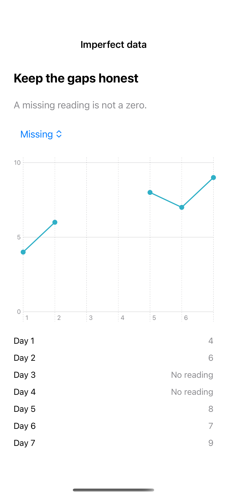

# Chart data edge cases

Empty, missing, negative, and extreme values need deliberate domains and honest gaps.

## SwiftUI

```swift
import SwiftUI
import Charts

struct GappedLineChart: View {
    let values: [Double?] = [4, 6, nil, nil, 8, 7, 9]
    var body: some View {
        Chart {
            ForEach(values.indices, id: \.self) { day in
                if let value = values[day] {
                    let segment = values.prefix(day).filter { $0 == nil }.count
                    LineMark(x: .value("Day", day), y: .value("Value", value),
                             series: .value("Segment", segment))
                    PointMark(x: .value("Day", day), y: .value("Value", value))
                }
            }
        }
        .frame(height: 240)
    }
}
```

## Captures

<!-- captures:start -->
### iPhone 16 Pro · iOS 18.5

default. light appearance; Large text; en_US.


<!-- captures:end -->

## Example notes

The chart uses fixed, fictional sample data. VoiceOver and direct manipulation still require manual device review.

## Full example

[Open the complete runnable example](ChartDataEdgeCasesDemo.swift).

## Reference

[Apple: Chart](https://developer.apple.com/documentation/charts/chart).
