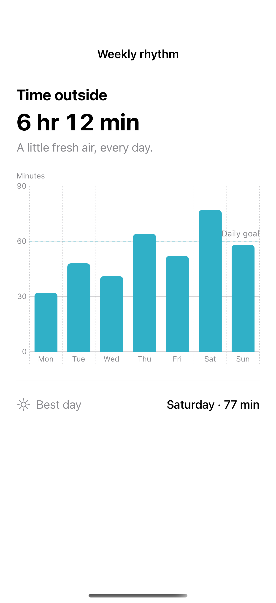

# Chart marks and axes

Bar, line, area, and point marks present the same data with different emphasis.

## SwiftUI

```swift
import SwiftUI
import Charts

struct WeeklyBarChart: View {
    let minutes = [32, 48, 41, 64, 52, 77, 58]
    var body: some View {
        Chart {
            ForEach(minutes.indices, id: \.self) { day in
                BarMark(x: .value("Day", day + 1), y: .value("Minutes", minutes[day]))
            }
            RuleMark(y: .value("Goal", 60))
                .lineStyle(StrokeStyle(dash: [4, 4]))
                .annotation(position: .top) { Text("Goal").font(.caption) }
        }
        .foregroundStyle(.teal)
        .chartYScale(domain: 0...90)
        .frame(height: 240)
    }
}
```

## Captures

<!-- captures:start -->
### iPhone 16 Pro · iOS 18.5

default. light appearance; Large text; en_US.


<!-- captures:end -->

## Example notes

The chart uses fixed, fictional sample data. VoiceOver and direct manipulation still require manual device review.

## Full example

[Open the complete runnable example](ChartMarkTypesDemo.swift).

## Reference

[Apple: Chart](https://developer.apple.com/documentation/charts/chart).
