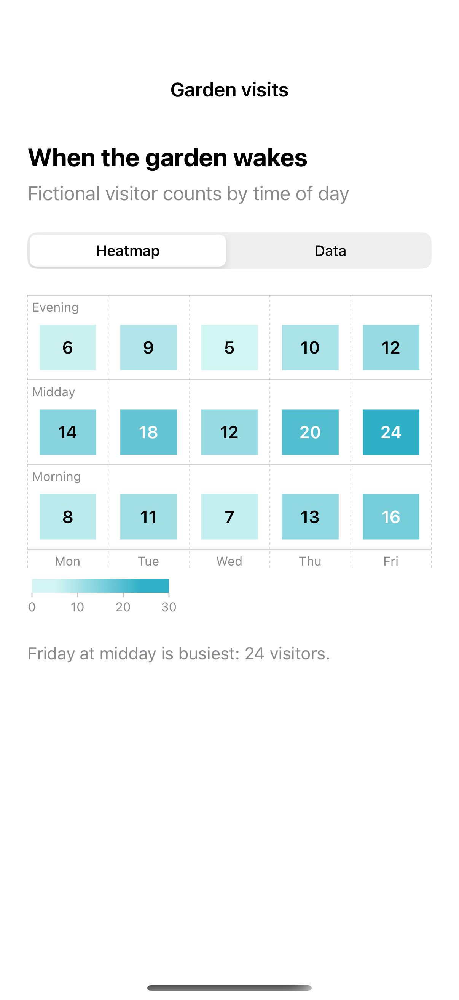

# Heatmaps and sortable data

Rectangle marks reveal a two-dimensional pattern while a table exposes exact values.

## SwiftUI

```swift
import SwiftUI
import Charts

struct VisitHeatmap: View {
    let counts = [[8, 14, 6], [11, 18, 9], [7, 12, 5]]
    var body: some View {
        Chart {
            ForEach(0..<3) { day in
                ForEach(0..<3) { period in
                    RectangleMark(x: .value("Day", day), y: .value("Period", period))
                        .foregroundStyle(by: .value("Visits", counts[day][period]))
                }
            }
        }
        .chartForegroundStyleScale(range: Gradient(colors: [.mint.opacity(0.2), .teal]))
        .frame(height: 240)
    }
}
```

## Captures

<!-- captures:start -->
### iPhone 16 Pro · iOS 18.5

default. light appearance; Large text; en_US.


<!-- captures:end -->

## Example notes

The chart uses fixed, fictional sample data. VoiceOver and direct manipulation still require manual device review.

## Full example

[Open the complete runnable example](HeatmapTableChartDemo.swift).

## Reference

[Apple: Chart](https://developer.apple.com/documentation/charts/chart).
