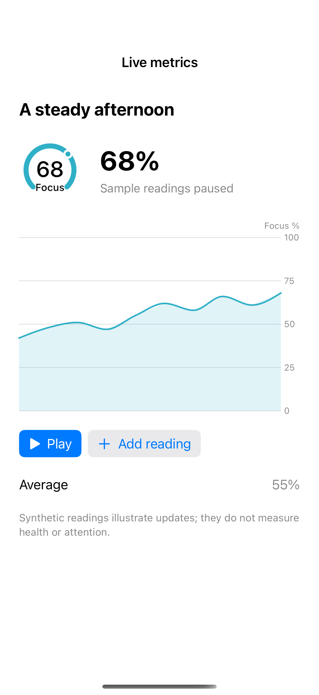

# Live charts and metrics

Appending readings updates a chart and its summary metrics from the same state.

## SwiftUI

```swift
import SwiftUI
import Charts

struct UpdatingChart: View {
    @Environment(\.accessibilityReduceMotion) private var reduceMotion
    @State private var values = [42, 48, 51, 47, 55]
    var body: some View {
        VStack {
            Chart(values.indices, id: \.self) { index in
                LineMark(x: .value("Reading", index), y: .value("Value", values[index]))
            }.chartYScale(domain: 0...100).frame(height: 240)
            Button("Add reading") {
                withAnimation(reduceMotion ? nil : .easeInOut) {
                    values.append((values.last! + 7) % 100)
                }
            }
        }
    }
}
```

## Captures

<!-- captures:start -->
### iPhone 16 Pro · iOS 18.5

default. light appearance; Large text; en_US.


<!-- captures:end -->

## Example notes

The chart uses fixed, fictional sample data. VoiceOver and direct manipulation still require manual device review.

## Full example

[Open the complete runnable example](LiveChartMetricsDemo.swift).

## Reference

[Apple: Chart](https://developer.apple.com/documentation/charts/chart).
