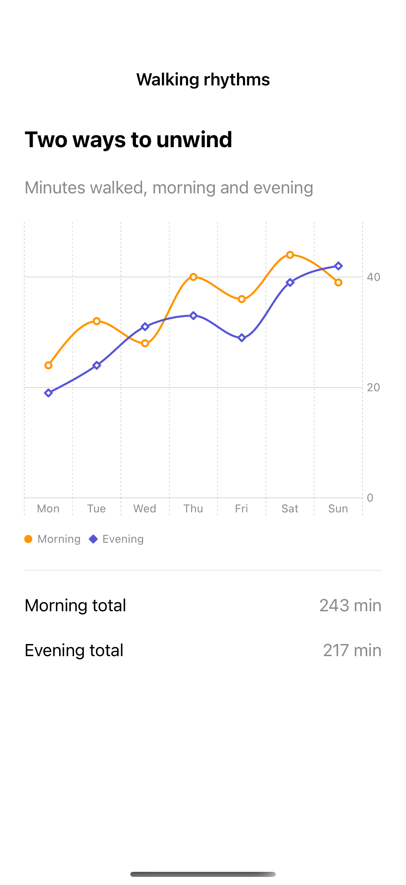

# Comparing chart series

Consistent colors, symbols, and a shared scale make multiple series easier to compare.

## SwiftUI

```swift
import SwiftUI
import Charts

struct ComparedSeries: View {
    let morning = [24, 32, 28, 40]
    let evening = [19, 24, 31, 33]
    var body: some View {
        Chart {
            ForEach(0..<4) { day in
                LineMark(x: .value("Day", day), y: .value("Minutes", morning[day]))
                    .foregroundStyle(by: .value("Time", "Morning"))
                    .symbol(by: .value("Time", "Morning"))
                LineMark(x: .value("Day", day), y: .value("Minutes", evening[day]))
                    .foregroundStyle(by: .value("Time", "Evening"))
                    .symbol(by: .value("Time", "Evening"))
            }
        }
        .chartLegend(position: .bottom)
        .frame(height: 240)
    }
}
```

## Captures

<!-- captures:start -->
### iPhone 16 Pro · iOS 18.5

default. light appearance; Large text; en_US.


<!-- captures:end -->

## Example notes

The chart uses fixed, fictional sample data. VoiceOver and direct manipulation still require manual device review.

## Full example

[Open the complete runnable example](MultiSeriesChartDemo.swift).

## Reference

[Apple: Chart](https://developer.apple.com/documentation/charts/chart).
