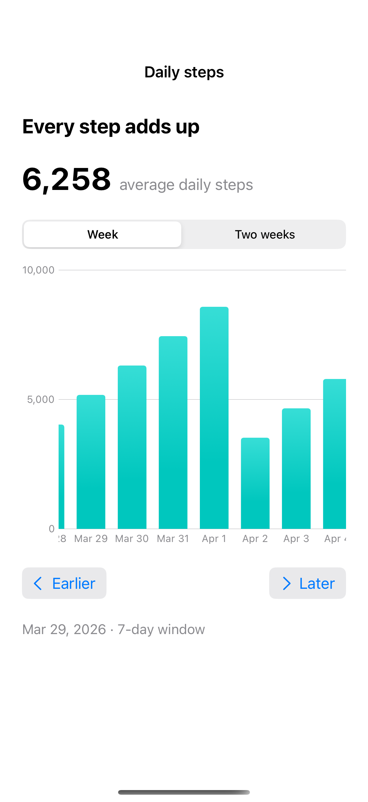

# Scrollable time series

A visible domain lets a long time series scroll while its axes retain a useful scale.

## SwiftUI

```swift
import SwiftUI
import Charts

struct ScrollableDays: View {
    @State private var position = Date(timeIntervalSince1970: 1772323200)
    let start = Date(timeIntervalSince1970: 1772323200)
    var body: some View {
        Chart(0..<30, id: \.self) { day in
            BarMark(x: .value("Date", start.addingTimeInterval(Double(day) * 86400), unit: .day),
                    y: .value("Steps", 3000 + day * 120))
        }
        .chartScrollableAxes(.horizontal)
        .chartXVisibleDomain(length: 7 * 86400)
        .chartScrollPosition(x: $position)
        .frame(height: 240)
    }
}
```

## Captures

<!-- captures:start -->
### iPhone 16 Pro · iOS 18.5

default. light appearance; Large text; en_US.


<!-- captures:end -->

## Example notes

The chart uses fixed, fictional sample data. VoiceOver and direct manipulation still require manual device review.

## Full example

[Open the complete runnable example](ScrollingTimeSeriesDemo.swift).

## Reference

[Apple: Chart](https://developer.apple.com/documentation/charts/chart).
