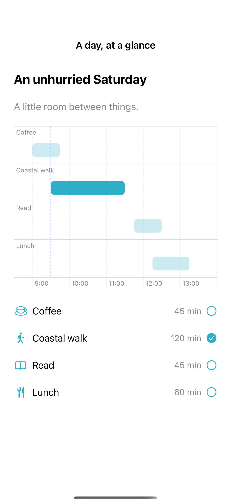

# Timeline charts

Ranged bar marks place durations on a shared timeline and make overlaps visible.

## SwiftUI

```swift
import SwiftUI
import Charts

struct RangedBarTimeline: View {
    var body: some View {
        Chart {
            BarMark(xStart: .value("Start", 9.0), xEnd: .value("End", 9.75), y: .value("Activity", "Coffee"))
            BarMark(xStart: .value("Start", 9.5), xEnd: .value("End", 11.5), y: .value("Activity", "Walk"))
            BarMark(xStart: .value("Start", 11.75), xEnd: .value("End", 12.5), y: .value("Activity", "Read"))
        }
        .chartXScale(domain: 8.5...14)
        .foregroundStyle(.teal)
        .frame(height: 220)
    }
}
```

## Captures

<!-- captures:start -->
### iPhone 16 Pro · iOS 18.5

default. light appearance; Large text; en_US.


<!-- captures:end -->

## Example notes

Times are fictional local clock-hour values. Selecting a row highlights the matching native ranged bar and its start time. Calendar and time-zone behavior belongs in a production scheduling model.

## Full example

[Open the complete runnable example](TimelineChartDemo.swift).

## Reference

[Apple documentation](https://developer.apple.com/documentation/charts/barmark).
