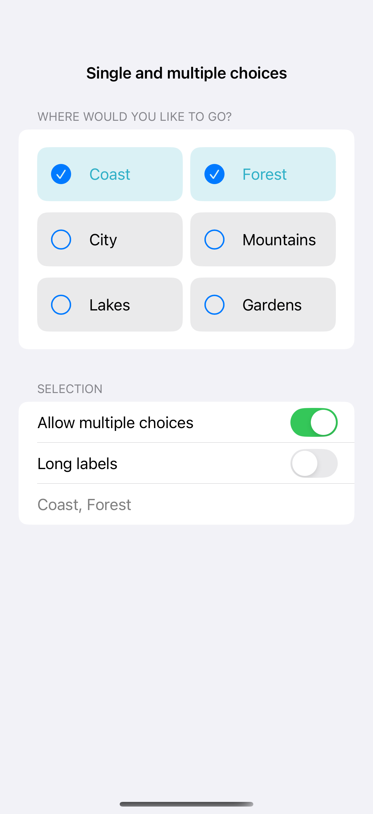
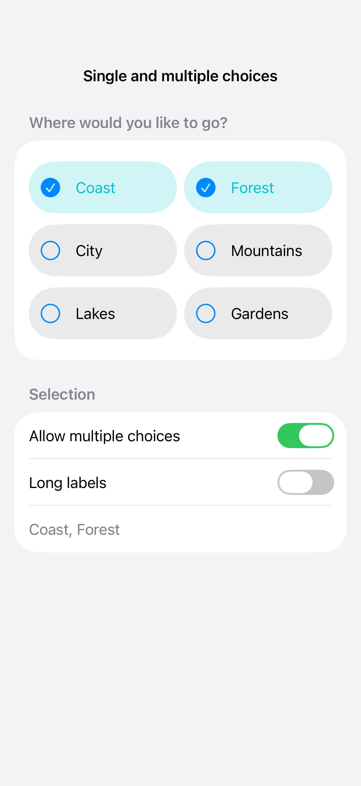

# Single and multiple choices

Custom choice chips use real buttons to select one option or a set of options. A visible selected treatment and accessibility selected traits keep the control understandable beyond color alone, while adaptive layout gives longer labels room to wrap.

## SwiftUI

```swift
import SwiftUI

struct ChoiceChipsRecipe: View {
    @State private var selected: Set<String> = ["Coast"]
    var body: some View {
        HStack {
            ForEach(["Coast", "Forest", "City"], id: \.self) { option in
                Button {
                    if selected.contains(option) { selected.remove(option) }
                    else { selected.insert(option) }
                } label: {
                    Label(option, systemImage: selected.contains(option) ? "checkmark.circle.fill" : "circle")
                }
                .buttonStyle(.bordered)
                .accessibilityAddTraits(selected.contains(option) ? .isSelected : [])
            }
        }
    }
}
```

## Captures

<!-- captures:start -->
### iPhone 16 Pro · iOS 18.5

default. light appearance; Large text; en_US.



### iPhone 17 Pro · iOS 26.5

default. light appearance; Large text; en_US.


### iPhone 18 Pro · iOS 27.0

default. light appearance; Large text; en_US.


<!-- captures:end -->

## Full example

[Open the complete runnable example](ChoiceChipsDemo.swift).

## Reference

[Apple: pickers](https://developer.apple.com/design/human-interface-guidelines/pickers).
