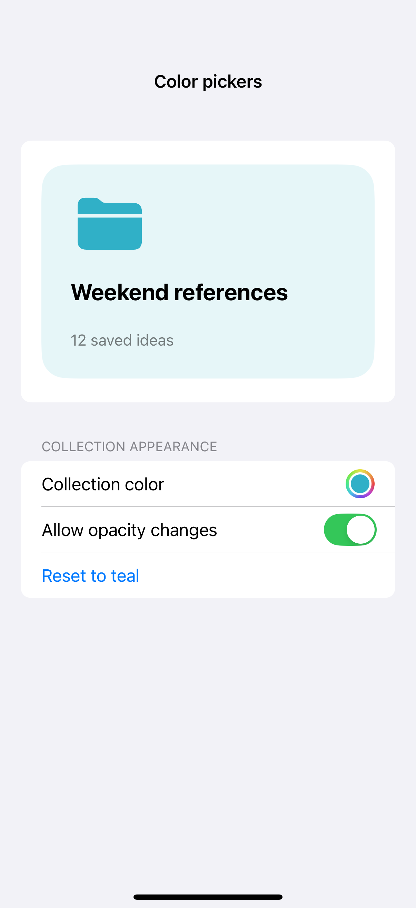
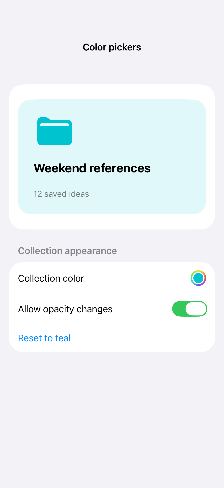
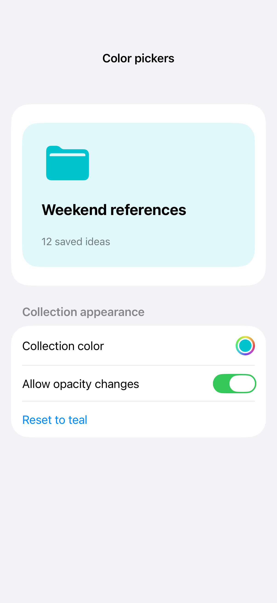

# Color pickers

A color picker opens the system color-selection interface and binds the result to your content. Optional opacity controls are useful when transparency is part of the design; hide them when the task requires an opaque color.

## SwiftUI

```swift
import SwiftUI

struct ColorPickerRecipe: View {
    @State private var color = Color.teal
    var body: some View {
        VStack(spacing: 24) {
            RoundedRectangle(cornerRadius: 24).fill(color).frame(height: 160)
            ColorPicker("Collection color", selection: $color, supportsOpacity: true)
        }.padding()
    }
}
```

## Captures

<!-- captures:start -->
### iPhone 16 Pro · iOS 18.5

default. light appearance; Large text; en_US.



### iPhone 17 Pro · iOS 26.5

default. light appearance; Large text; en_US.



### iPhone 18 Pro · iOS 27.0

default. light appearance; Large text; en_US.


<!-- captures:end -->

## Full example

[Open the complete runnable example](ColorPickersDemo.swift).

## Reference

[Apple: pickers](https://developer.apple.com/design/human-interface-guidelines/pickers).
