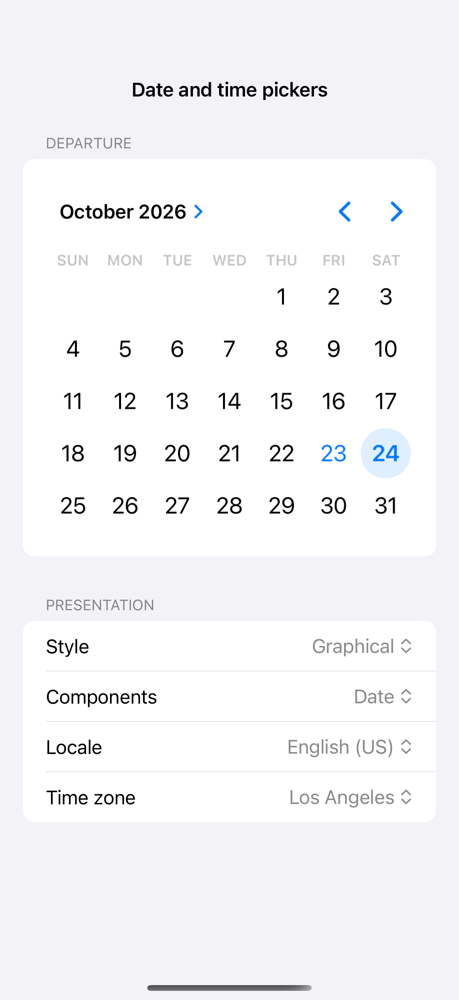
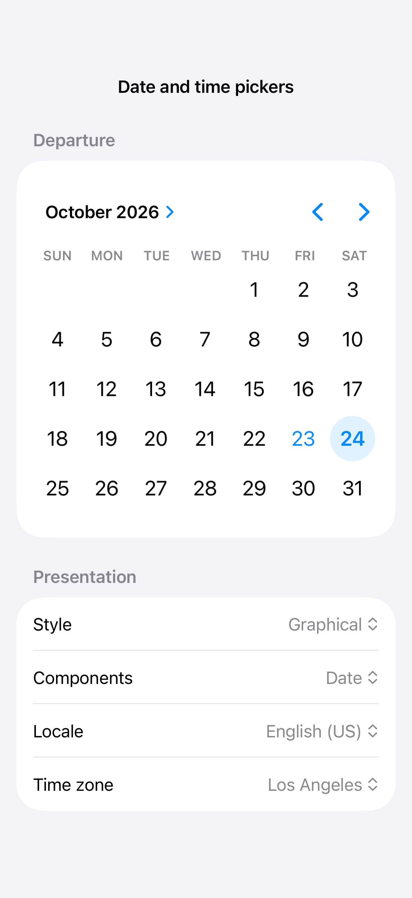
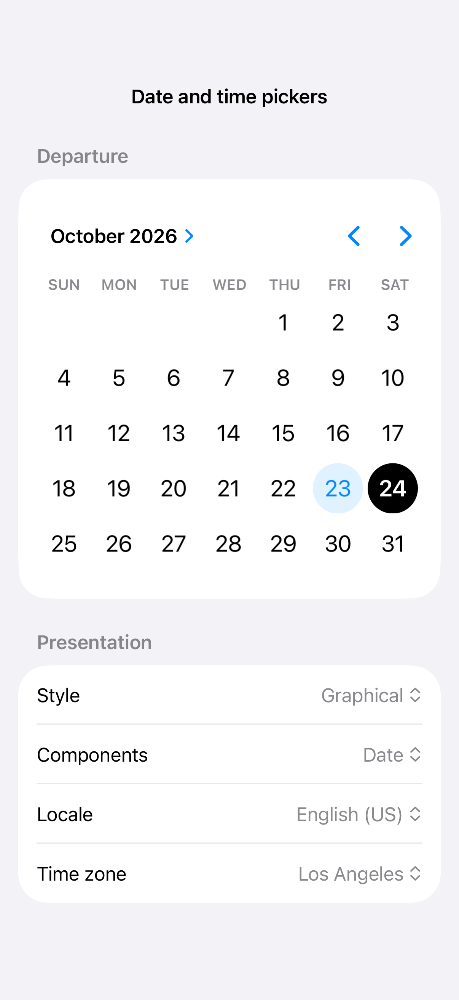

# Date and time pickers

A date picker uses the current calendar, locale, and time zone to present a date or time. Compact, wheel, and graphical styles offer different amounts of context, and the displayed components determine whether the task needs a date, a time, or both.

## SwiftUI

```swift
import SwiftUI

struct DatePickerRecipe: View {
    @State private var date = Date()
    var body: some View {
        DatePicker("Departure", selection: $date, displayedComponents: [.date, .hourAndMinute])
            .datePickerStyle(.compact)
    }
}
```

## Captures

<!-- captures:start -->
### iPhone 16 Pro · iOS 18.5

default. light appearance; Large text; en_US.



### iPhone 17 Pro · iOS 26.5

default. light appearance; Large text; en_US.



### iPhone 18 Pro · iOS 27.0

default. light appearance; Large text; en_US.


<!-- captures:end -->

## Full example

[Open the complete runnable example](DatePickerStylesDemo.swift).

## Reference

[Apple: pickers](https://developer.apple.com/design/human-interface-guidelines/pickers).
