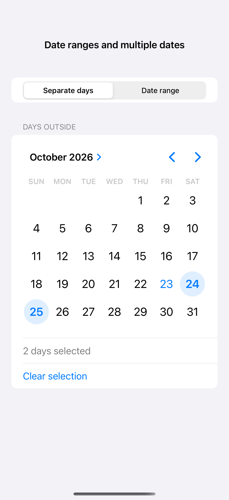
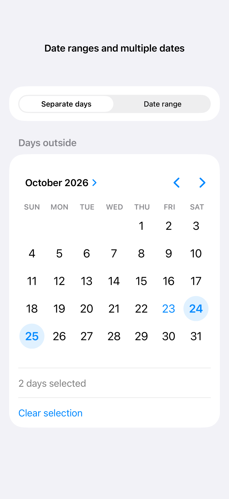
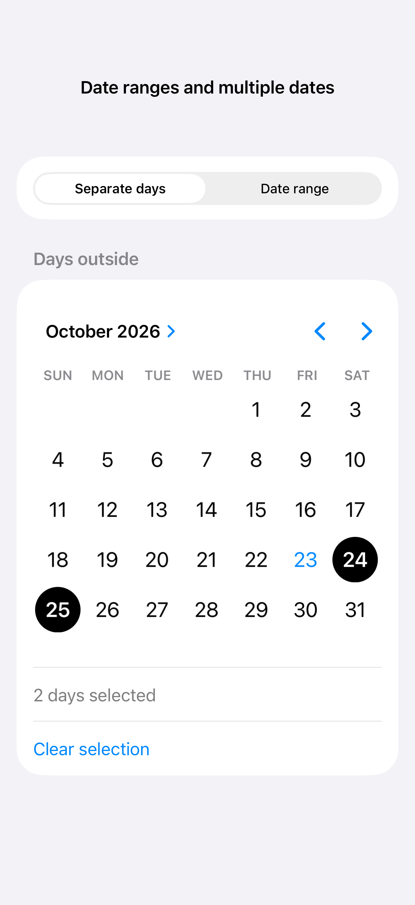

# Date ranges and multiple dates

A date range uses two related endpoints, while a multi-date picker selects separate calendar days. Constrain the end date to follow the start and store multiple selections as date components in the picker’s calendar.

## SwiftUI

```swift
import SwiftUI

struct MultipleDatesRecipe: View {
    @State private var dates: Set<DateComponents> = []
    var body: some View {
        MultiDatePicker("Available days", selection: $dates)
            .padding()
    }
}
```

## Captures

<!-- captures:start -->
### iPhone 16 Pro · iOS 18.5

default. light appearance; Large text; en_US.



### iPhone 17 Pro · iOS 26.5

default. light appearance; Large text; en_US.



### iPhone 18 Pro · iOS 27.0

default. light appearance; Large text; en_US.


<!-- captures:end -->

## Full example

[Open the complete runnable example](DateSelectionDemo.swift).

## Reference

[Apple: pickers](https://developer.apple.com/design/human-interface-guidelines/pickers).
