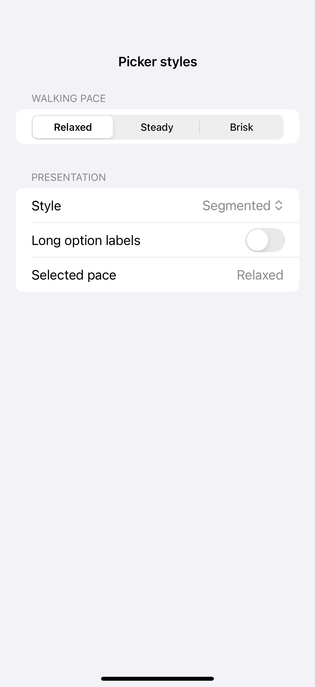
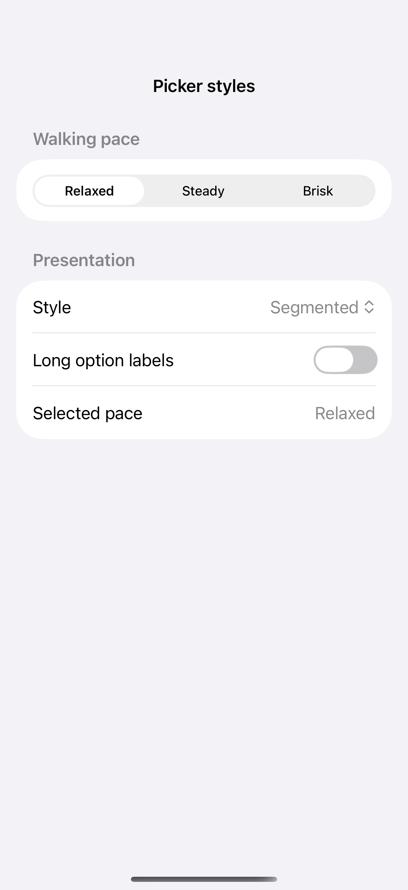
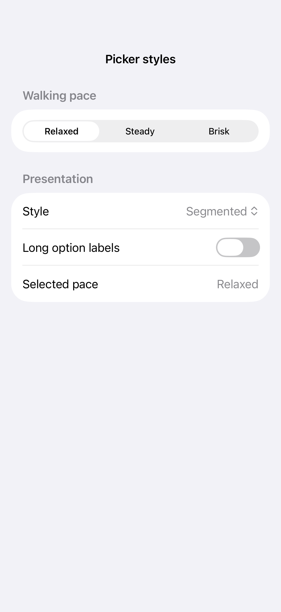

# Picker styles

A picker binds one selection to a set of tagged values. Its style changes how the choices appear, from compact segments and menus to inline rows, a wheel, or a separate navigation destination.

## SwiftUI

```swift
import SwiftUI

struct PickerStylesRecipe: View {
    @State private var pace = "Relaxed"
    var body: some View {
        Picker("Walking pace", selection: $pace) {
            Text("Relaxed").tag("Relaxed")
            Text("Steady").tag("Steady")
            Text("Brisk").tag("Brisk")
        }
        .pickerStyle(.segmented)
    }
}
```

## Captures

<!-- captures:start -->
### iPhone 16 Pro · iOS 18.5

default. light appearance; Large text; en_US.



### iPhone 17 Pro · iOS 26.5

default. light appearance; Large text; en_US.



### iPhone 18 Pro · iOS 27.0

default. light appearance; Large text; en_US.


<!-- captures:end -->

## Full example

[Open the complete runnable example](PickerStylesDemo.swift).

## Reference

[Apple: pickers](https://developer.apple.com/design/human-interface-guidelines/pickers).
