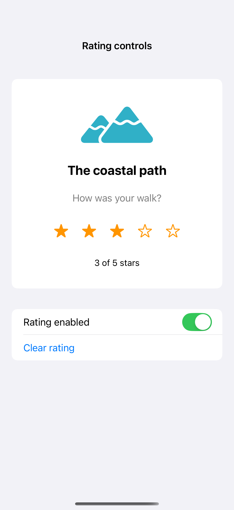
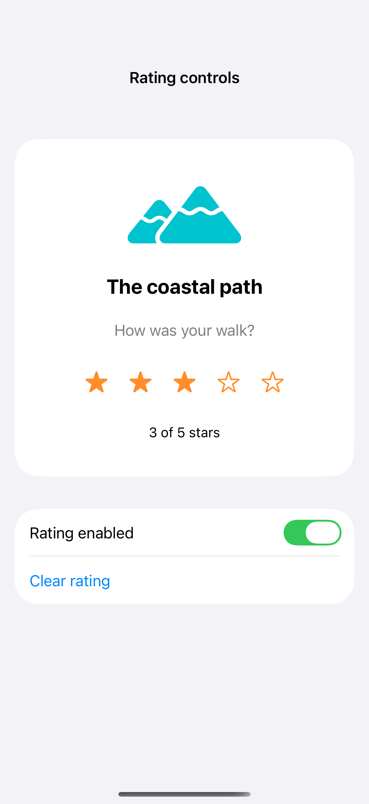

# Rating controls

A custom rating control can use individual buttons for touch and expose one adjustable value to VoiceOver. Clear bounds, a spoken value, and a way to reset the rating make the interaction complete.

## SwiftUI

```swift
import SwiftUI

struct RatingRecipe: View {
    @State private var rating = 3
    var body: some View {
        HStack {
            ForEach(1...5, id: \.self) { value in
                Button { rating = value } label: {
                    Image(systemName: value <= rating ? "star.fill" : "star")
                        .frame(minWidth: 44, minHeight: 44)
                }
            }
        }
        .accessibilityElement(children: .ignore)
        .accessibilityLabel("Rating")
        .accessibilityValue("\(rating) out of 5 stars")
        .accessibilityAdjustableAction { direction in
            switch direction {
            case .increment: rating = min(5, rating + 1)
            case .decrement: rating = max(0, rating - 1)
            @unknown default: break
            }
        }
    }
}
```

## Captures

<!-- captures:start -->
### iPhone 16 Pro · iOS 18.5

default. light appearance; Large text; en_US.



### iPhone 17 Pro · iOS 26.5

default. light appearance; Large text; en_US.



### iPhone 18 Pro · iOS 27.0

default. light appearance; Large text; en_US.


<!-- captures:end -->

## Full example

[Open the complete runnable example](RatingControlsDemo.swift).

## Reference

[Apple: pickers](https://developer.apple.com/design/human-interface-guidelines/pickers).
