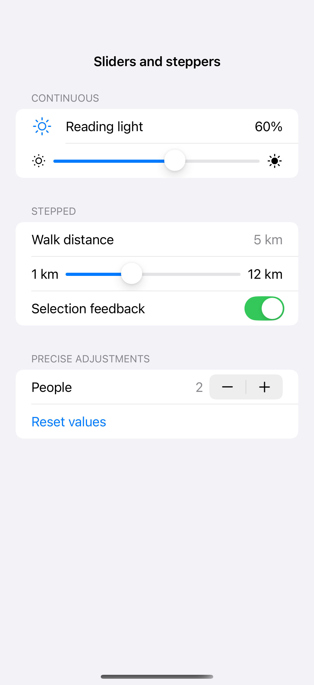
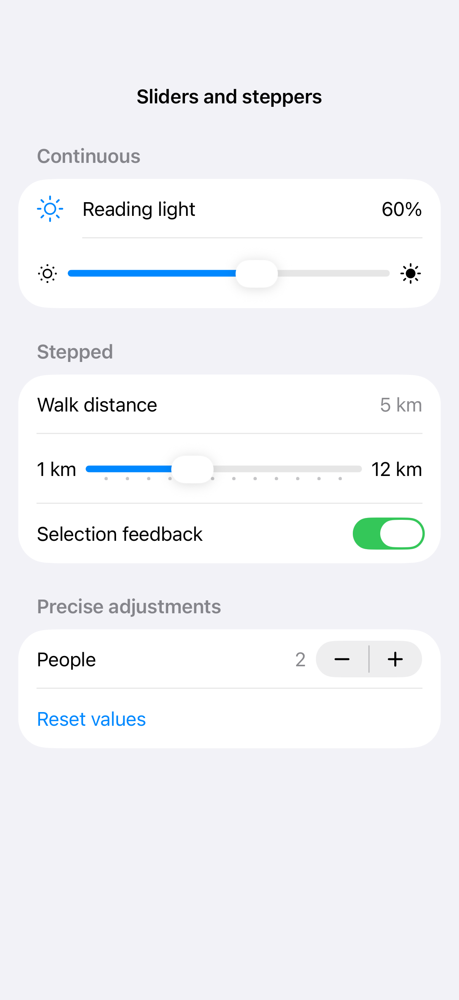

# Sliders and steppers

A slider makes a range easy to explore, while a stepper gives precise bounded changes. Endpoint labels, formatted values, and subtle selection feedback make the scale and current value understandable.

## SwiftUI

```swift
import SwiftUI

struct SliderStepperRecipe: View {
    @State private var brightness = 0.6
    @State private var copies = 2
    var body: some View {
        Form {
            Slider(value: $brightness, in: 0...1) { Text("Brightness") }
            Stepper("Copies: \(copies)", value: $copies, in: 1...10)
        }
    }
}
```

## Captures

<!-- captures:start -->
### iPhone 16 Pro · iOS 18.5

default. light appearance; Large text; en_US.



### iPhone 17 Pro · iOS 26.5

default. light appearance; Large text; en_US.


### iPhone 18 Pro · iOS 27.0

default. light appearance; Large text; en_US.


<!-- captures:end -->

## Full example

[Open the complete runnable example](SlidersAndSteppersDemo.swift).

## Reference

[Apple: pickers](https://developer.apple.com/design/human-interface-guidelines/pickers).
