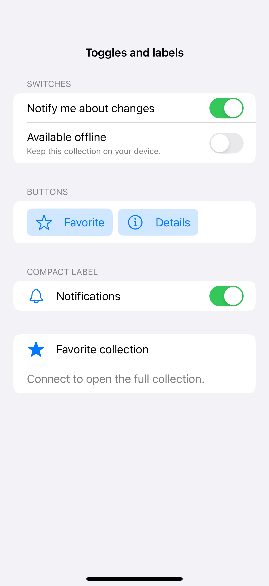
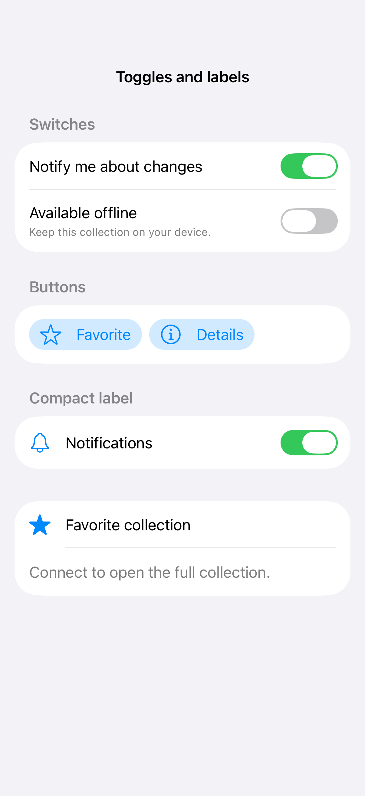

# Toggles and labels

A toggle represents a persistent on-or-off value. Switch and button styles suit different layouts, while labels keep the meaning clear even when the visual treatment shows only a symbol.

## SwiftUI

```swift
import SwiftUI

struct ToggleStylesRecipe: View {
    @State private var favorite = false
    var body: some View {
        Toggle(isOn: $favorite) {
            Label("Favorite", systemImage: "star")
        }
        .toggleStyle(.button)
    }
}
```

## Captures

<!-- captures:start -->
### iPhone 16 Pro · iOS 18.5

default. light appearance; Large text; en_US.



### iPhone 17 Pro · iOS 26.5

default. light appearance; Large text; en_US.


<!-- captures:end -->

## Full example

[Open the complete runnable example](ToggleStylesDemo.swift).

## Reference

[Apple: pickers](https://developer.apple.com/design/human-interface-guidelines/pickers).
