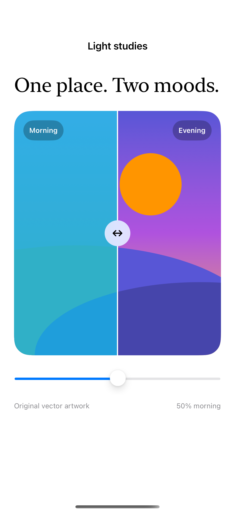

# An artwork comparison slider

A custom reveal mask compares two original artworks without resizing either side. The native `Slider` supplies an equivalent adjustment for keyboard and accessibility input.

## SwiftUI

```swift
import SwiftUI

struct RevealComparison: View {
    @State private var amount = 0.5
    var body: some View {
        VStack {
            GeometryReader { proxy in
                ZStack(alignment: .leading) {
                    Rectangle().fill(.indigo.gradient)
                    Rectangle().fill(.teal.gradient)
                        .mask(alignment: .leading) { Rectangle().frame(width: proxy.size.width * amount) }
                    Rectangle().fill(.white).frame(width: 2).offset(x: proxy.size.width * amount)
                }.clipShape(.rect(cornerRadius: 20))
            }.frame(height: 260)
            Slider(value: $amount, in: 0...1) { Text("Reveal amount") }
        }.padding()
    }
}
```

## Captures

<!-- captures:start -->
### iPhone 16 Pro · iOS 18.5

default. light appearance; Large text; en_US.


<!-- captures:end -->

## Full example

[Open the complete runnable example](ArtworkComparisonSliderDemo.swift).

## Reference

[Apple documentation](https://developer.apple.com/documentation/swiftui/view/mask(alignment:_:)).
