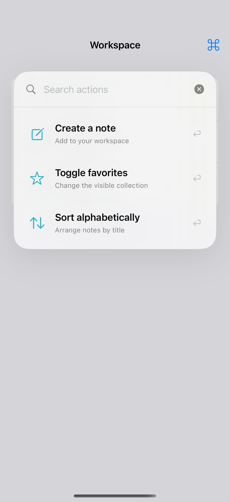

# A searchable command palette

A custom command palette filters actions and executes the selected command. A native `Menu` is usually sufficient for a short, fixed list of actions.

## SwiftUI

```swift
import SwiftUI

struct ActionSearch: View {
    @State private var query = ""
    @State private var favorites = false
    var body: some View {
        VStack(alignment: .leading) {
            TextField("Search actions", text: $query).textFieldStyle(.roundedBorder)
            if query.isEmpty || "Toggle favorites".localizedCaseInsensitiveContains(query) {
                Button("Toggle favorites", systemImage: "star") { favorites.toggle() }
            }
            Text(favorites ? "Showing favorites" : "Showing all notes")
        }.padding(24).background(.regularMaterial, in: .rect(cornerRadius: 24))
    }
}
```

## Captures

<!-- captures:start -->
### iPhone 16 Pro · iOS 18.5

default. light appearance; Large text; en_US.


<!-- captures:end -->

## Full example

[Open the complete runnable example](CommandSearchPaletteDemo.swift).

## Reference

[Apple documentation](https://developer.apple.com/documentation/swiftui/view/keyboardshortcut(_:modifiers:)).
