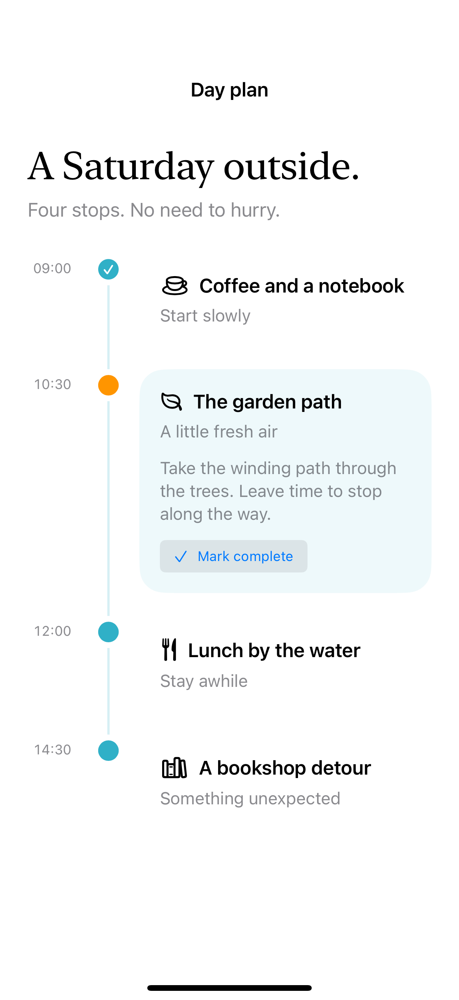

# A day-plan timeline

A custom timeline connects events and expands the selected stop. A sectioned `List` is the native alternative when simple chronological rows are enough.

## SwiftUI

```swift
import SwiftUI

struct SimpleTimeline: View {
    var body: some View {
        VStack(spacing: 0) {
            ForEach(0..<3) { index in
                HStack(alignment: .top, spacing: 16) {
                    VStack(spacing: 0) {
                        Circle().fill(.teal).frame(width: 14, height: 14)
                        Rectangle().fill(.teal.opacity(0.2)).frame(width: 2)
                    }.frame(width: 20)
                    VStack(alignment: .leading, spacing: 6) {
                        Text("Stop \(index + 1)").font(.headline)
                        Text("A little room in the day.").foregroundStyle(.secondary)
                    }.padding(.bottom, 28)
                    Spacer()
                }.fixedSize(horizontal: false, vertical: true)
            }
        }.padding()
    }
}
```

## Captures

<!-- captures:start -->
### iPhone 16 Pro · iOS 18.5

default. light appearance; Large text; en_US.


<!-- captures:end -->

## Full example

[Open the complete runnable example](DayPlanTimelineDemo.swift).

## Reference

[Apple documentation](https://developer.apple.com/documentation/swiftui/list).
