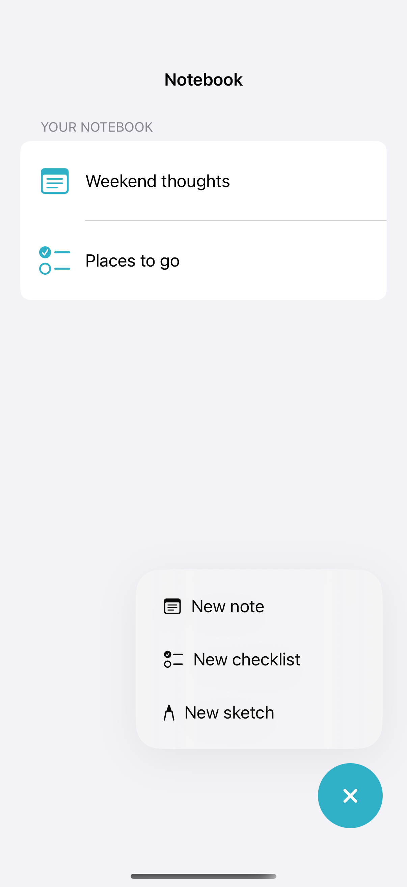

# A floating action tray

A custom action tray keeps creation choices visible beside the main action. A native `Menu` or toolbar is the simpler alternative for a standard action list.

## SwiftUI

```swift
import SwiftUI

struct CreationTray: View {
    @State private var expanded = false
    @State private var notes = 0
    var body: some View {
        Text("\(notes) notes").frame(maxWidth: .infinity, maxHeight: .infinity)
            .safeAreaInset(edge: .bottom, alignment: .trailing) {
                VStack(alignment: .trailing) {
                    if expanded {
                        Button("New note", systemImage: "note.text") { notes += 1; expanded = false }
                            .padding().background(.regularMaterial, in: .rect(cornerRadius: 20))
                    }
                    Button(expanded ? "Close" : "Create", systemImage: expanded ? "xmark" : "plus") {
                        withAnimation { expanded.toggle() }
                    }.buttonStyle(.borderedProminent)
                }.padding()
            }
    }
}
```

## Captures

<!-- captures:start -->
### iPhone 16 Pro · iOS 18.5

default. light appearance; Large text; en_US.


<!-- captures:end -->

## Full example

[Open the complete runnable example](FloatingCreationTrayDemo.swift).

## Reference

[Apple documentation](https://developer.apple.com/documentation/swiftui/menu).
