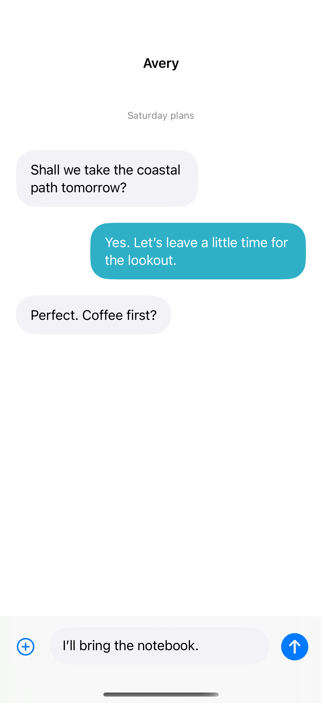

# A growing chat composer

Local message bubbles surround a native multiline TextField that grows to five lines. A `TextEditor` is a better starting point for longer document editing.

## SwiftUI

```swift
import SwiftUI

struct MessageComposer: View {
    @State private var draft = ""
    @State private var sent: [String] = []
    var body: some View {
        List(sent.indices, id: \.self) { Text(sent[$0]) }
            .safeAreaInset(edge: .bottom) {
                HStack(alignment: .bottom) {
                    TextField("Message", text: $draft, axis: .vertical).lineLimit(1...5)
                        .textFieldStyle(.roundedBorder)
                    Button("Send", systemImage: "arrow.up.circle.fill") {
                        sent.append(draft); draft = ""
                    }.disabled(draft.trimmingCharacters(in: .whitespacesAndNewlines).isEmpty)
                }.padding().background(.bar)
            }
    }
}
```

## Captures

<!-- captures:start -->
### iPhone 16 Pro · iOS 18.5

default. light appearance; Large text; en_US.


<!-- captures:end -->

## Full example

[Open the complete runnable example](GrowingChatComposerDemo.swift).

## Reference

[Apple documentation](https://developer.apple.com/documentation/swiftui/textfield).
