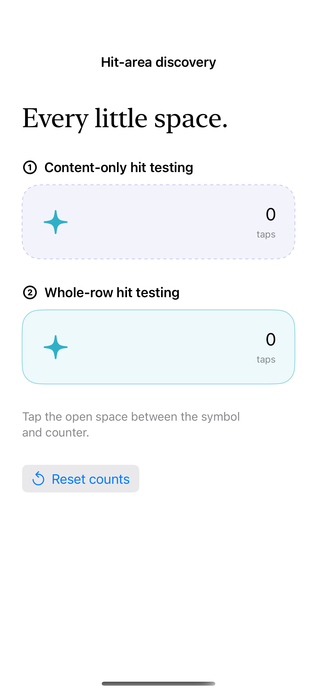

# One modifier, a larger hit area

An original before-and-after study inspired by Sarun’s [SwiftUI Plain Button Style cannot tap on an Empty space](https://sarunw.com/posts/swiftui-plain-button-style-cannot-tap/) (26 June 2023). `contentShape` defines the custom label’s hit region; keep a native Button so activation and accessibility semantics remain intact.

## SwiftUI

```swift
import SwiftUI

struct TappableCardRow: View {
    @State private var selected = false
    var body: some View {
        Button { selected.toggle() } label: {
            HStack {
                Label("Save this idea", systemImage: "bookmark")
                Spacer(minLength: 60)
                Image(systemName: selected ? "checkmark.circle.fill" : "circle")
            }
            .padding(24)
            .contentShape(Rectangle())
        }
        .buttonStyle(.plain)
        .background(.teal.opacity(0.08), in: .rect(cornerRadius: 22))
        .accessibilityValue(selected ? "Saved" : "Not saved")
    }
}
```

## Captures

<!-- captures:start -->
### iPhone 16 Pro · iOS 18.5

default. light appearance; Large text; en_US.


<!-- captures:end -->

## Full example

[Open the complete runnable example](PlainButtonHitAreaDemo.swift).

## Reference

[Apple documentation](https://developer.apple.com/documentation/swiftui/view/contentshape(_:eofill:)).
