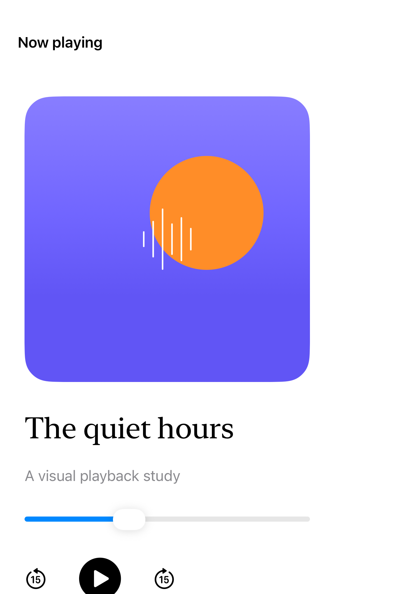
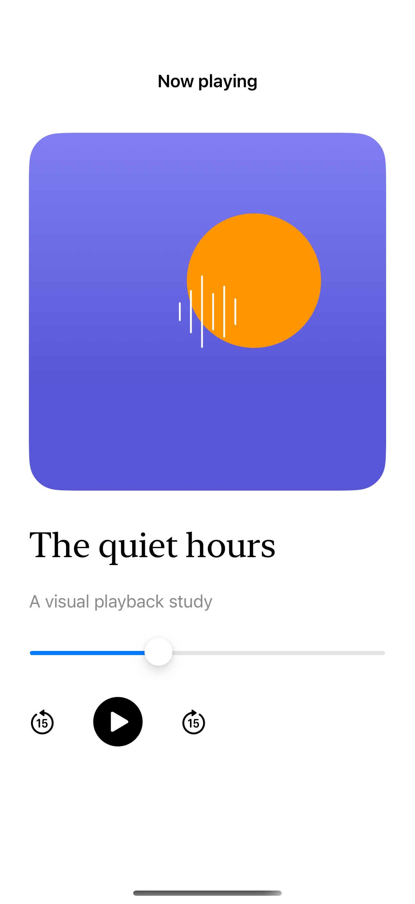
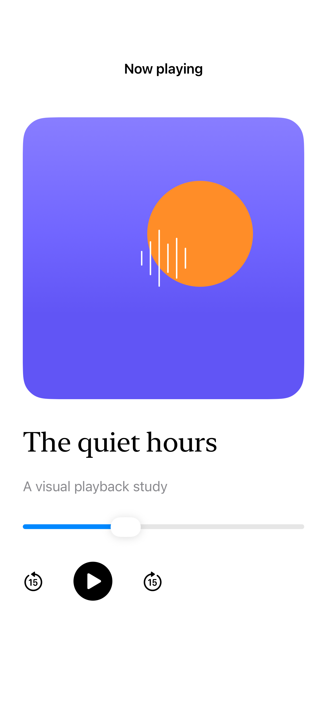

# Adaptive media composition

A media composition can move its controls beside or below content using the current view size, without relying on screen dimensions or device orientation.

## SwiftUI

```swift
import SwiftUI

struct MediaAndControls: View {
    var body: some View {
        GeometryReader { proxy in
            let layout = proxy.size.width > 700
                ? AnyLayout(HStackLayout()) : AnyLayout(VStackLayout())
            layout {
                Rectangle().fill(.indigo.gradient)
                    .aspectRatio(16.0 / 9.0, contentMode: .fit)
                Button("Play", systemImage: "play.fill") { }
                    .buttonStyle(.bordered)
            }.padding()
        }
    }
}
```

## Captures

<!-- captures:start -->
### iPhone Duo · iOS 27.1

default. light appearance; Large text; en_US.



### iPhone 16 Pro · iOS 18.5

default. light appearance; Large text; en_US.



### iPhone 17 Pro · iOS 26.5

default. light appearance; Large text; en_US.


<!-- captures:end -->

## Full example

[Open the complete runnable example](AdaptiveMediaCompositionDemo.swift).

## Reference

[Apple: GeometryReader](https://developer.apple.com/documentation/swiftui/geometryreader).
