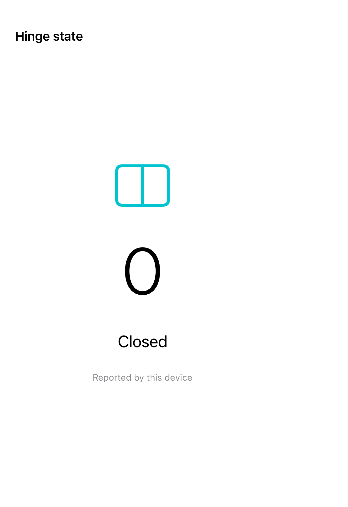

# Live hinge observation

Hinge-change events expose the angle and system-classified status on supported hardware; this example never substitutes simulated hinge data.

These iOS 27.1 APIs are marked beta in Apple’s documentation and require iOS 27.1.

## SwiftUI

```swift
import SwiftUI

@available(iOS 27.1, *)
struct LiveHingeAngle: View {
    @State private var hinge: DeviceHinge?
    var body: some View {
        Group {
            if let hinge {
                Text(hinge.angle.degrees, format: .number.precision(.fractionLength(0)))
            } else {
                Text("No hinge data reported")
            }
        }
        .onHingeChange { _, context in hinge = context.hinge }
    }
}
```

## Captures

<!-- captures:start -->
### iPhone Duo · iOS 27.1

default. light appearance; Large text; en_US.


<!-- captures:end -->

## Full example

[Open the complete runnable example](HingeObservationDemo.swift).

## Reference

[Apple: onHingeChange](https://developer.apple.com/documentation/swiftui/devicehinge).
