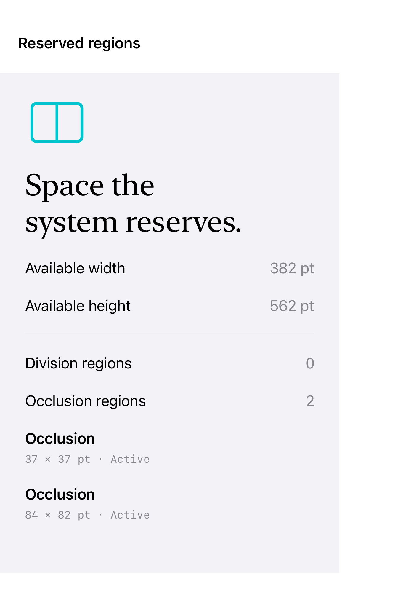

# Reserved regions

Reserved-region queries report geometry that divides or occludes a view; this inspector draws only the regions the current device actually supplies.

These iOS 27.1 APIs are marked beta in Apple’s documentation and require iOS 27.1.

## SwiftUI

```swift
import SwiftUI

@available(iOS 27.1, *)
struct DivisionRegions: View {
    var body: some View {
        GeometryReader { proxy in
            let divisions = proxy.reservedRegions(kind: .division)
            ZStack {
                Color.clear
                ForEach(divisions) { region in
                    Rectangle().fill(.teal.opacity(0.2))
                        .frame(width: region.frame.width, height: region.frame.height)
                        .position(x: region.frame.midX, y: region.frame.midY)
                }
            }
        }
    }
}
```

## Captures

<!-- captures:start -->
### iPhone Duo · iOS 27.1

default. light appearance; Large text; en_US.


<!-- captures:end -->

## Full example

[Open the complete runnable example](ReservedRegionInspectionDemo.swift).

## Reference

[Apple: GeometryProxy.reservedRegions](https://developer.apple.com/documentation/swiftui/reservedregion).
