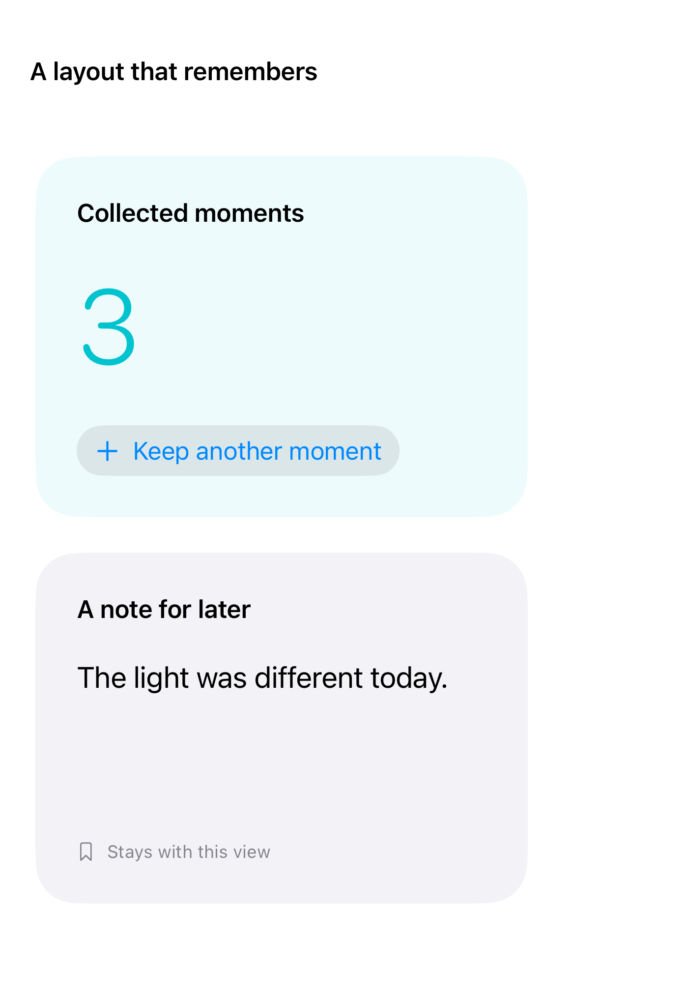
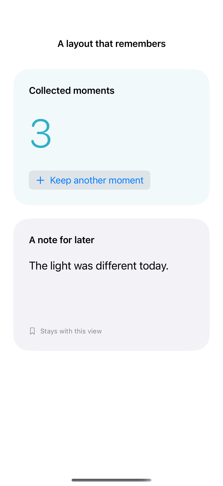
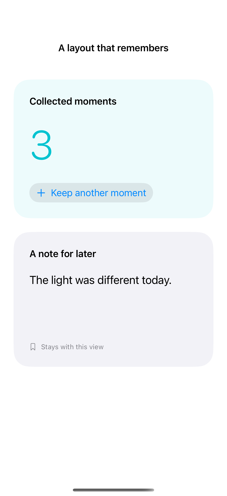

# Preserving state while resizing

AnyLayout changes a container’s layout while preserving the identities of its child views, including their local state.

## SwiftUI

```swift
import SwiftUI

struct ResizingCounter: View {
    @State private var count = 0
    var body: some View {
        GeometryReader { proxy in
            let layout = proxy.size.width > 600
                ? AnyLayout(HStackLayout()) : AnyLayout(VStackLayout())
            layout {
                Text("\(count)").font(.largeTitle)
                Button("Add one") { count += 1 }
            }.padding()
        }
    }
}
```

## Captures

<!-- captures:start -->
### iPhone Duo · iOS 27.1

default. light appearance; Large text; en_US.



### iPhone 16 Pro · iOS 18.5

default. light appearance; Large text; en_US.



### iPhone 17 Pro · iOS 26.5

default. light appearance; Large text; en_US.


<!-- captures:end -->

## Full example

[Open the complete runnable example](ResizeStatePreservationDemo.swift).

## Reference

[Apple: AnyLayout](https://developer.apple.com/documentation/swiftui/anylayout).
