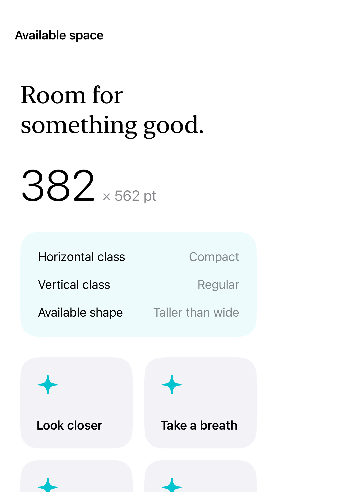
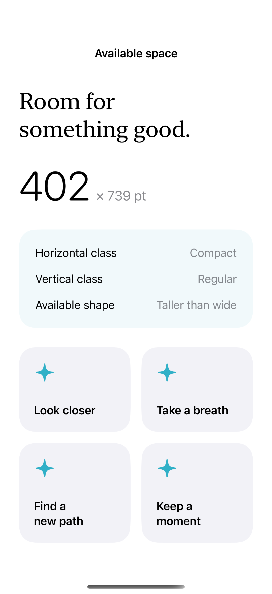
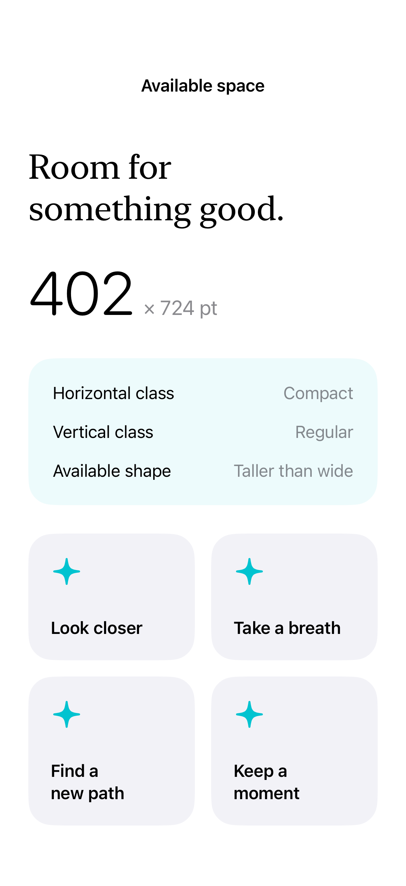

# Size class and actual geometry

Available geometry and size classes describe a view’s environment; neither should be treated as a device-name check.

## SwiftUI

```swift
import SwiftUI

struct AvailableWidth: View {
    @Environment(\.horizontalSizeClass) private var sizeClass
    var body: some View {
        GeometryReader { proxy in
            VStack {
                Text("\(Int(proxy.size.width)) points wide")
                Text(sizeClass == .regular ? "Regular width class" : "Compact or unspecified")
            }.frame(maxWidth: .infinity, maxHeight: .infinity)
        }
    }
}
```

## Captures

<!-- captures:start -->
### iPhone Duo · iOS 27.1

default. light appearance; Large text; en_US.



### iPhone 16 Pro · iOS 18.5

default. light appearance; Large text; en_US.



### iPhone 17 Pro · iOS 26.5

default. light appearance; Large text; en_US.


<!-- captures:end -->

## Full example

[Open the complete runnable example](SizeClassGeometryDemo.swift).

## Reference

[Apple: GeometryReader](https://developer.apple.com/documentation/swiftui/geometryreader).
