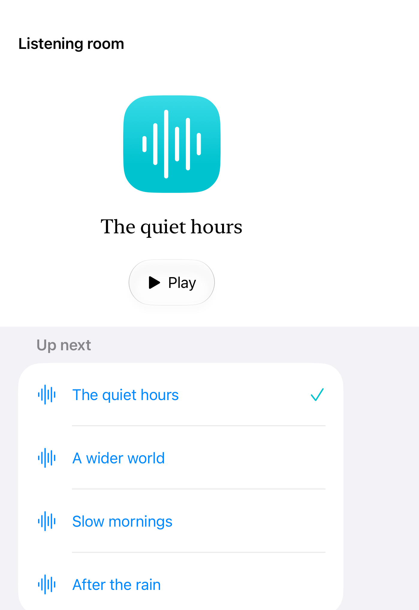

# Native split arrangements

A split arrangement distributes primary and secondary content using the available shape and reserved regions; fold-specific behavior requires a supported folding device.

These iOS 27.1 APIs are marked beta in Apple’s documentation and require iOS 27.1.

## SwiftUI

```swift
import SwiftUI

@available(iOS 27.1, *)
struct PrimaryAndSecondary: View {
    var body: some View {
        ArrangementView {
            Text("Now playing").frame(maxWidth: .infinity, maxHeight: .infinity)
        } secondary: {
            List { Text("Up next"); Text("A wider world") }
        }
        .arrangementViewStyle(.split)
    }
}
```

## Captures

<!-- captures:start -->
### iPhone Duo · iOS 27.1

default. light appearance; Large text; en_US.


<!-- captures:end -->

## Full example

[Open the complete runnable example](SplitArrangementsDemo.swift).

## Reference

[Apple: ArrangementView](https://developer.apple.com/documentation/swiftui/arrangementview).
