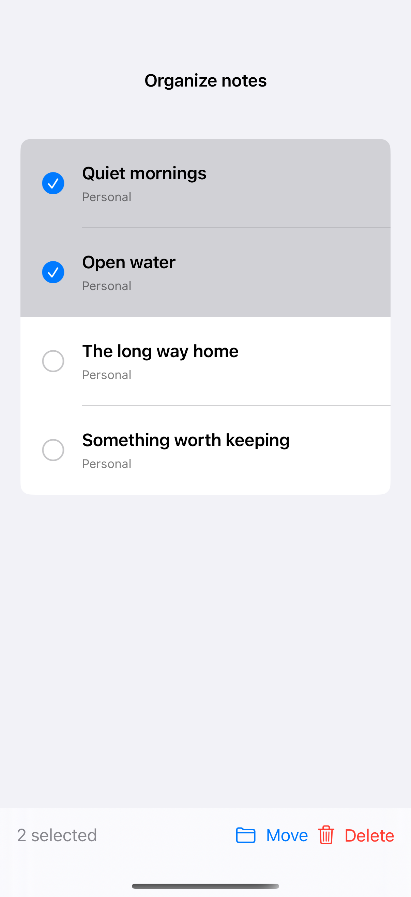

# Batch actions and recovery

A selection flow groups related actions, confirms destructive changes, and offers a direct undo.

## SwiftUI

```swift
import SwiftUI

struct RecoverableBatchDelete: View {
    @State private var items = ["Quiet mornings", "Open water"]
    @State private var selection: Set<String> = []
    @State private var removed: [String] = []

    var body: some View {
        VStack {
            List(items, id: \.self, selection: $selection) { Text($0) }
                .environment(\.editMode, .constant(.active))
            Button("Delete selected", role: .destructive) {
                removed = items.filter { selection.contains($0) }
                items.removeAll { selection.contains($0) }
                selection = []
            }
            Button("Undo") { items.append(contentsOf: removed); removed = [] }
                .disabled(removed.isEmpty)
        }
    }
}
```

## Captures

<!-- captures:start -->
### iPhone 16 Pro · iOS 18.5

default. light appearance; Large text; en_US.


<!-- captures:end -->

## Example notes

All changes stay in this example; no account or remote data is modified.

## Full example

[Open the complete runnable example](BatchEditingRecoveryDemo.swift).

## Reference

[Apple: Form](https://developer.apple.com/documentation/swiftui/form).
